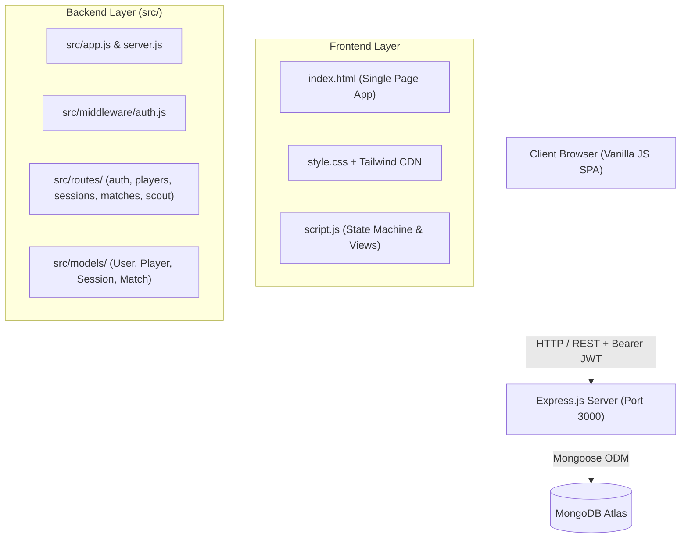
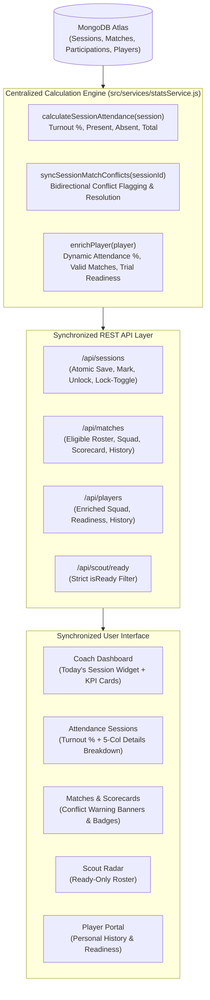

# MaidanDesk (Academy ERP) — Complete Project Context & AI Chatbot Knowledge Base

> **Purpose of this Document:**  
> This file is the single source of truth for **MaidanDesk**. Any AI chatbot, LLM assistant, or developer working on this codebase should read this file first. It contains the business rules, architecture, database schemas, API contracts, frontend state model, UI/UX guidelines, demo data, and strict development constraints. Where earlier versions described separate Lock steps or absent-by-default workflows, the **v2** rules documented here take absolute precedence.
>
> **Latest frontend review (3 Nov 2026):** See **Section 13 — Frontend UX, Navigation & Clarity Review** for the AI-agent audit of the current frontend, its navigation gaps, and the prioritized remediation plan. It documents current implementation drift without changing the v2 business rules.

---

## 1. Executive Summary & Purpose

**MaidanDesk** is a modern, full-stack Sports Academy Management Platform (Academy ERP) engineered for sports academies and grassroots athlete development (originally developed for the **Dumka Sports Hackathon**). 

The platform replaces fragile paper registers and spreadsheets with a cohesive, data-driven system that manages:
1. **Athlete rosters & demographics** (with registration dates and default participation types).
2. **Session-by-session attendance tracking** with default-Present rosters, per-entry participation granularity, and atomic single-step immutability upon saving.
3. **Match recording and complete results reporting** (`played` with integer scores vs `did_not_play`), guarded strictly by saved training attendance.
4. **Automated Trial Readiness evaluation** using integer arithmetic thresholds for talent scouting.
5. **Role-isolated portals** for Academy Admins, Coaches, Scouts, and Athletes.

---

## 2. Core Problem Statement & Strict Business Rules (v2)

Any AI chatbot modifying or expanding this codebase **MUST** uphold these non-negotiable rules:

### Rule 1: Attendance Lifecycle — Default Present, Per-Entry Participation, Single-Step Immutability
* **Default Present:** Opening a session creates every athlete belonging to that coach in that sport with `status: 'present'` and `participation` equal to the player's `defaultParticipation` (`'practice'`, `'match'`, or `'both'`).
* **Participation Granularity:** 
  * When present, an athlete's participation reason is explicitly recorded as `'practice'`, `'match'`, or `'both'`.
  * If marked `absent`, their participation is strictly `null` (or disabled/dashed in the UI).
* **Single-Step Save & Immutability:** 
  * There are **NO separate Lock buttons** in the UI.
  * Saving attendance (`PATCH /api/sessions/:id/save`) is the single atomic action that sets `saved: true`, records `savedAt`, and seals the session.
  * Once saved (`session.saved === true`), the session is **strictly immutable**. Subsequent modifications (`PATCH /bulk`, `PATCH /mark`, or re-saving) return `409 Conflict`.
  * The session has two UI states: **Draft** (opened, not yet saved) and **Saved** (read-only, immutable).
* **Compound Uniqueness:** A coach can open at most one session per date and sport. Duplicate creations return `409 Conflict`.

> **Current UI drift (audited 3 Nov 2026):** The rule above is the intended v2 model: one save action with no separate lock controls. The current frontend still exposes "Lock Session" / "Unlock Session" controls and the backend retains `PATCH /api/sessions/:id/toggle-lock`. Until that drift is resolved, treat this rule as the target behavior, not as an accurate description of the current UI. See §13.6.

### Rule 2: Match-Day Attendance Guard & Complete Match Results
* **Saved Session Prerequisite:** A match fixture on date $D$ for sport $S$ cannot have player entries recorded (`PUT /api/matches/:id/entries`) unless a **saved** session exists for that exact date and sport. An unsaved draft session or missing session returns `409 Conflict`.
* **Eligible Athletes Only:** Only athletes who were marked `status: 'present'` AND had participation `'match'` or `'both'` in that day's saved session are eligible for match scoring.
* **Strict Rejections (`422 Unprocessable Entity`):**
  * Submitting an absent player returns `422` with that player's ID.
  * Submitting a practice-only player returns `422` with that player's ID.
  * Omitting any eligible player returns `422` with that player's ID.
* **Complete Results Reporting:** Every eligible player must be resolved with either:
  1. `result: 'played'` with an integer score $\ge 0$.
  2. `result: 'did_not_play'` with `score: null`.
  The two states are mutually exclusive in the UI (score input vs "Did not play" toggle).

### Rule 3: Trial Readiness Formula (Exact Integer Comparison)
An athlete is eligible for talent trials (`READY` status) if and only if **both** conditions are met:
$$\text{Attendance Rate} \ge 75\% \quad \text{AND} \quad \text{Matches Played} \ge 2$$
* **Evaluation Logic:** Evaluated using integer arithmetic: `presentCount * 4 >= totalCount * 3 && matchesPlayed >= 2`.
* Only saved sessions count towards official attendance calculations.
* Only match entries with `result === 'played'` count toward matches played.
* If Attendance $< 75\%$ OR Matches Played $< 2$, the athlete is `NOT READY` (In Training).
* The visual progress bar for matches played is calibrated against the target of **2 matches** (capped visually at $100\%$, even if $>2$).

### Rule 4: Strict Scout & Athlete Isolation
* **Scouts** (`/api/scout/ready`) **ONLY** see athletes where `isReady === true`. Developing athletes are strictly omitted.
* **Athletes** (`/api/players/me`, `/api/matches`) see only their personal profile, saved attendance history, and matches where they had `result === 'played'`.

### Rule 5: Zero Native Browser Dialogs
* Never call native `alert()`, `confirm()`, or `prompt()`.
* All user feedback must use the glassmorphic modal system (`openModal(...)`) or animated toast notifications (`showToast(...)`).

---

## 3. High-Level Technical Architecture



### Technology Stack
* **Frontend (target)**: Next.js App Router + TypeScript + Tailwind in `client/`, calling the Express API via a Next.js rewrite. **Frontend (legacy, frozen fallback)**: Vanilla SPA (index.html, script.js, style.css).
* **Backend**: Node.js, Express.js 5.x.
* **Database**: MongoDB Atlas via Mongoose 9.x.
* **Authentication**: JSON Web Tokens (`jsonwebtoken`) + `bcryptjs` password hashing.
* **State & Persistence**: Client state cached in memory (`script.js`) + JWT token and user profile in `localStorage`.

---

## 4. Complete Project Directory & File Map

```
c:\Users\Kamran\Desktop\hackathon\
├── client/                    # NEW Next.js frontend (App Router). Express in src/ is frozen.
├── .env                       # Environment variables (PORT, MONGODB_URI, JWT_SECRET)
├── .env.example               # Template for environment configuration
├── .gitignore                 # Standard node_modules & env exclusions
├── index.html                 # Main Single Page Application shell & all view containers
├── script.js                  # Frontend SPA controller, state management, and modal logic
├── style.css                  # Custom glassmorphic styling, animations, and Tailwind overrides
├── package.json               # NPM package dependencies, scripts (test, seed, dev, start)
├── CHANGELOG.md               # Detailed changelog of API modifications, status codes, deprecations
├── PROJECT_CONTEXT.md         # THIS FILE (Comprehensive AI Knowledge Base & Architectural Authority)
├── context.md                 # Root reference alias to PROJECT_CONTEXT.md
├── scripts/
│   ├── seed.js                # Database seeding with 24 athletes (md260001-md260024), 10 Ready / 14 Not Ready
│   ├── migrate-v2.js          # Idempotent migration script converting legacy v1 data to v2
│   ├── migrate-player-usernames.js # Assigns sequential md<YY><NNNN> IDs & links User accounts
│   ├── verify-player-links.js # Audits bi-directional User <-> Player references
│   ├── cleanup-orphaned-match-entries.js # Standing maintenance tool to purge deleted player references
│   └── fix-session-rosters.js # Maintenance utility checking session roster integrity
├── src/
│   ├── app.js                 # Express application configuration and route mounting
│   ├── server.js              # HTTP server bootstrapper and MongoDB Atlas connection
│   ├── middleware/
│   │   └── auth.js            # JWT verification & role authorization (admin, coach, scout, player)
│   ├── models/
│   │   ├── User.js            # User authentication schema (username, email, role, playerId ref)
│   │   ├── Player.js          # Athlete schema (name, age, sport, playerId, user ref, registeredOn, defaultParticipation)
│   │   ├── Counter.js         # Atomic sequence counter for unique sequential IDs (md<YY><NNNN>)
│   │   ├── Session.js         # Training session schema (saved, savedAt, locked, initialRosterPlayerIds, attendance array)
│   │   ├── Match.js           # Match fixture schema (title, sport, date, time, opponent, venue, status, selectedPlayers, hasConflict, conflictMessage)
│   │   └── MatchParticipation.js # Per-player participation schema (match, player, coach, played, score, attendanceConflict, conflictReason)
│   ├── routes/
│   │   ├── auth.js            # Authentication routes (/api/auth, username/playerId & email login)
│   │   ├── players.js         # Player directory & profile management (/api/players)
│   │   ├── sessions.js        # Attendance sessions, atomic saving, unlock & lock toggling (/api/sessions)
│   │   ├── matches.js         # Fixtures, calendar, squad, participation & scoring (/api/matches)
│   │   └── scout.js           # Scout radar evaluation endpoint (/api/scout)
│   ├── services/
│   │   └── statsService.js    # Centralized calculation service (turnout %, dynamic attendance %, valid matches, trial readiness, conflict sync)
│   └── utils/
│       ├── coach.js           # Coach resolution utilities
│       ├── idGenerator.js     # Sequential player ID generator (md<YY><NNNN>)
│       └── sport.js           # Sport regex and normalization helpers
└── test/
    ├── acceptance.test.js     # 20-scenario core acceptance test suite
    ├── data-synchronization.test.js # 10-scenario comprehensive Atlas data synchronization suite
    ├── player-identity.test.js # Player username login & sequential ID generation test suite
    ├── session-roster-integrity.test.js # Snapshot roster immutability test suite
    ├── match-phase1.test.js   # MatchParticipation model and compound index test
    ├── match-phase2.test.js   # Fixture CRUD & calendar aggregation test
    ├── match-phase3.test.js   # Attendance eligibility derivation & squad selection test
    ├── match-phase4.test.js   # Participation scoring & match completion test
    ├── match-phase5.test.js   # Reopen, history, & player stats test
    ├── match-phase6.test.js   # Trial Readiness integration test
    └── match-phase8.test.js   # Frontend contract & 403 cross-coach isolation test
```

---

## 5. Database Schemas (Mongoose)

### 1. `User` Schema (`src/models/User.js`)
```javascript
{
  username: { type: String, required: true, unique: true, trim: true },
  email:    { type: String, required: true, unique: true, lowercase: true, trim: true },
  password: { type: String, required: true },
  name:     { type: String, required: true, trim: true },
  role:     { type: String, enum: ['admin', 'coach', 'scout', 'player'], default: 'player' },
  playerId: { type: mongoose.Schema.Types.ObjectId, ref: 'Player', default: null }
}
```

### 2. `Player` Schema (`src/models/Player.js`)
```javascript
{
  name:                 { type: String, required: true, trim: true },
  age:                  { type: Number, required: true, min: 5, max: 50 },
  sport:                { type: String, required: true, trim: true },
  playerId:             { type: String, unique: true, index: true, uppercase: true, trim: true }, // Format: md<YY><NNNN>
  user:                 { type: mongoose.Schema.Types.ObjectId, ref: 'User', default: null },
  registeredOn:         { type: Date, required: true, default: Date.now }, // Cannot be future date
  defaultParticipation: { type: String, enum: ['practice', 'match', 'both'], default: 'both' },
  coach:                { type: mongoose.Schema.Types.ObjectId, ref: 'User', required: true }
}
```

### 3. `Counter` Schema (`src/models/Counter.js`)
Atomic sequence tracker enabling collision-free sequential ID generation (`md<YY><NNNN>`) with annual rollover:
```javascript
{
  key: { type: String, required: true, unique: true }, // e.g. "player_id_2026"
  seq: { type: Number, default: 0 }
}
```

### 4. `Session` Schema (`src/models/Session.js`)
```javascript
const attendanceEntrySchema = new mongoose.Schema({
  player:        { type: mongoose.Schema.Types.ObjectId, ref: 'Player', required: true },
  status:        { type: String, enum: ['present', 'absent'], default: 'present' },
  participation: { type: String, enum: ['practice', 'match', 'both', null], default: 'both' }
}, { _id: false });

const sessionSchema = new mongoose.Schema({
  date:       { type: Date, required: true },
  sport:      { type: String, required: true, trim: true },
  coach:      { type: mongoose.Schema.Types.ObjectId, ref: 'User', required: true },
  saved:      { type: Boolean, default: false },
  savedAt:    { type: Date, default: null },
  locked:     { type: Boolean, default: false }, // Synced alias for backward compatibility
  attendance: {
    type: [attendanceEntrySchema],
    validate: {
      validator: function(entries) {
        if (!entries || !Array.isArray(entries)) return true;
        const seen = new Set();
        for (const e of entries) {
          const pid = (e.player?._id || e.player)?.toString();
          if (!pid) continue;
          if (seen.has(pid)) return false;
          seen.add(pid);
        }
        return true;
      },
      message: 'Duplicate attendance record for the same player in this session'
    }
  },
  // Immutable creation snapshot: protects roster against retroactive pollution
  initialRosterPlayerIds: [{ type: mongoose.Schema.Types.ObjectId, ref: 'Player' }],
  createdWithCount: { type: Number }
}, { timestamps: true });

// Compound unique index: at most one session per coach, date, and sport
sessionSchema.index({ coach: 1, date: 1, sport: 1 }, { unique: true });
```

### 5. `Match` Schema (`src/models/Match.js`)
```javascript
const matchSchema = new mongoose.Schema({
  coach:             { type: mongoose.Schema.Types.ObjectId, ref: 'User', required: true },
  title:             { type: String, required: true, trim: true },
  sport:             { type: String, required: true, trim: true },
  date:              { type: Date, required: true },
  time:              { type: String, default: '' },
  opponent:          { type: String, required: true, trim: true },
  venue:             { type: String, required: true, trim: true },
  description:       { type: String, default: '' },
  status:            { type: String, enum: ['upcoming', 'completed', 'cancelled'], default: 'upcoming' },
  completedAt:       { type: Date, default: null },
  sessionId:         { type: mongoose.Schema.Types.ObjectId, ref: 'Session', default: null },
  selectedPlayers:   [{ type: mongoose.Schema.Types.ObjectId, ref: 'Player' }],
  hasConflict:       { type: Boolean, default: false },
  conflictMessage:   { type: String, default: '' },
  editUnlockedUntil: { type: Date, default: null },
  entries:           [matchEntrySchema] // Legacy fallback compatibility
}, { timestamps: true });

// Compound unique index: at most one match fixture per coach, date, sport, opponent
matchSchema.index({ coach: 1, date: 1, sport: 1, opponent: 1 }, { unique: true });

// Virtual getter providing backward compatibility for legacy scores consumers
matchSchema.virtual('scores').get(function() {
  return (this.entries || [])
    .filter(e => e.result === 'played')
    .map(e => ({ player: e.player, score: e.score }));
});
```

### 6. `MatchParticipation` Schema (`src/models/MatchParticipation.js`)
```javascript
const matchParticipationSchema = new mongoose.Schema({
  match:              { type: mongoose.Schema.Types.ObjectId, ref: 'Match', required: true },
  player:             { type: mongoose.Schema.Types.ObjectId, ref: 'Player', required: true },
  coach:              { type: mongoose.Schema.Types.ObjectId, ref: 'User', required: true },
  played:             { type: Boolean, default: null }, // true (played), false (did not play), null (unresolved/upcoming)
  score:              { type: Number, default: null },  // required >= 0 if played: true for scored sports; null if played: false
  remarks:            { type: String, default: '', trim: true },
  attendanceConflict: { type: Boolean, default: false }, // true if player marked absent/practice in linked attendance session
  conflictReason:     { type: String, default: '' }
}, { timestamps: true });

// Compound unique index: athlete can be drafted at most once per match fixture
matchParticipationSchema.index({ match: 1, player: 1 }, { unique: true });
```

---

## 6. Complete REST API Reference

All protected endpoints require the HTTP Header: `Authorization: Bearer <JWT_TOKEN>`.

### Authentication (`/api/auth`)
| Method | Endpoint | Allowed Roles | Description | Payload / Response |
| :--- | :--- | :--- | :--- | :--- |
| `POST` | `/api/auth/login` | Public | Authenticates user by username or email | `{ email, password }` or `{ username, password }` |
| `GET` | `/api/auth/me` | All Roles | Returns the authenticated user profile | None |

### Players (`/api/players`)
| Method | Endpoint | Allowed Roles | Description | Payload / Response |
| :--- | :--- | :--- | :--- | :--- |
| `GET` | `/api/players` | `admin`, `coach` | Returns coach's squad enriched with attendanceRate, matchesPlayed, isReady | Returns array of enriched players |
| `POST` | `/api/players` | `admin`, `coach` | Enrolls a new athlete with registration date and default participation | `{ name, age, sport, registeredOn?, defaultParticipation? }`<br>**400** if future date or invalid participation. |
| `PATCH`| `/api/players/:id`| `admin`, `coach`| Updates athlete profile fields | `{ name?, age?, sport?, registeredOn?, defaultParticipation? }` |
| `GET` | `/api/players/:id/attendance-history`| `admin`, `coach`| Returns complete athlete attendance & match history breakdown | Returns `{ player, attendance: { rate, presentCount, totalCount, records }, matches: { totalMatchesPlayed, totalMatchesSelected, totalMatchesNotPlayed, history }, isReady }` |
| `GET` | `/api/players/me` | `player` | Returns personal athlete profile & readiness stats | Returns single enriched player |

### Sessions & Attendance (`/api/sessions`)
| Method | Endpoint | Allowed Roles | Description | Payload / Status Codes |
| :--- | :--- | :--- | :--- | :--- |
| `GET` | `/api/sessions` | `admin`, `coach`, `player` | Returns sessions (coaches see own, players see saved with their participation, admin sees all). | Populates `attendance.player`. |
| `POST` | `/api/sessions` | `admin`, `coach` | Opens session with snapshotted default Present roster (`initialRosterPlayerIds`). | `{ date, sport }`<br>**409** if duplicate `(coach, date, sport)`. |
| `GET` | `/api/sessions/:id`| `admin`, `coach`, `player` | Returns single session with roster. | **403** if coach belongs to another academy. |
| `PATCH`| `/api/sessions/:id/save`| `admin`, `coach`| **Atomically saves attendance roster, recalculates turnout, and syncs match conflicts.** | `{ attendance?: [{ player/playerId, status, participation? }] }`<br>**403** if cross-coach; **409** if locked; **400** if duplicate players. Returns `{ session, conflicts }`. |
| `PATCH`| `/api/sessions/:id/bulk`| `admin`, `coach`| Updates draft roster before saving. | `{ attendance: [{ playerId, status, participation }] }`<br>**403** if cross-coach; **409** if locked. Returns `{ session, conflicts }`. |
| `PATCH`| `/api/sessions/:id/mark`| `admin`, `coach`| Updates single athlete in draft roster and synchronizes linked match conflicts. | `{ playerId, status, participation? }`<br>**403** if cross-coach; **409** if locked. Returns `{ entry, session, conflicts }`. |
| `PATCH`| `/api/sessions/:id/unlock`| `admin`, `coach`| Unlocks a locked session for authorized corrections. | **403** if cross-coach; **400** if already unlocked. |
| `PATCH`| `/api/sessions/:id/toggle-lock`| `admin`, `coach`| Toggles lock/unlock state and updates match conflicts. | **403** if cross-coach. Returns `{ session, locked, conflicts }`. |
| `PATCH`| `/api/sessions/:id/lock`| `admin`, `coach`| *Deprecated alias* for save endpoint. | **403** if cross-coach; **409** if already locked. |

### Matches & Scoring (`/api/matches`)
| Method | Endpoint | Allowed Roles | Description | Payload / Status Codes |
| :--- | :--- | :--- | :--- | :--- |
| `GET` | `/api/matches` | All Roles | Returns matches (filtered to played-only for players; supports sport/status/opponent/dates) | Array of match objects |
| `POST` | `/api/matches` | `admin`, `coach` | Creates new upcoming fixture with duplicate guard | `{ title, sport, date, time?, opponent, venue?, description? }`<br>**409** if duplicate fixture. |
| `GET` | `/api/matches/calendar` | `admin`, `coach` | Returns monthly match aggregation for calendar view | Query: `?month=YYYY-MM` |
| `GET` | `/api/matches/history` | `admin`, `coach` | Returns completed match history with attendance & scorers | Query: `?sport=&search=&from=&to=` |
| `GET` | `/api/matches/:id` | All Roles | Returns single match fixture with computed counts | None |
| `PATCH`| `/api/matches/:id` | `admin`, `coach` | Updates match details (restricted to upcoming status) | `{ title?, sport?, date?, time?, opponent?, venue?, description? }`<br>**409** if not upcoming. |
| `PATCH`| `/api/matches/:id/cancel` | `admin`, `coach` | Cancels upcoming match fixture | **409** if not upcoming. |
| `GET` | `/api/matches/:id/eligible-players` | `admin`, `coach` | Derives eligible squad athletes strictly from saved attendance | Returns `{ sessionFound, eligiblePlayers, count }` |
| `PUT` | `/api/matches/:id/selected-players` | `admin`, `coach` | Idempotently sets drafted match squad | `{ playerIds: [...] }`<br>**422** if ineligible player included. |
| `GET` | `/api/matches/:id/participation` | `admin`, `coach` | Retrieves squad participation table and scores | Returns `{ matchId, participations: [...] }` |
| `PATCH`| `/api/matches/:id/participation/:playerId` | `admin`, `coach` | Updates individual athlete scorecard | `{ played: Boolean, score?: Number }`<br>**400** if played:false has score, or numeric sport missing score. |
| `PATCH`| `/api/matches/:id/complete` | `admin`, `coach` | Marks match as completed after validating all statuses | **400** if any drafted player has unresolved played status. |
| `PATCH`| `/api/matches/:id/reopen-for-edit` | `admin`, `coach` | Reopens completed match back to upcoming for corrections | Restores fixture to upcoming state. |
| `PUT` | `/api/matches/:id/entries` | `admin`, `coach` | *Legacy bulk scoring endpoint* | `{ entries: [{ playerId, result, score }] }` |

### Scout Radar (`/api/scout`)
| Method | Endpoint | Allowed Roles | Description | Response Filter |
| :--- | :--- | :--- | :--- | :--- |
| `GET` | `/api/scout/ready` | `admin`, `scout` | Returns talent radar of trial-ready athletes | Only returns athletes where `isReady === true` ($\ge 75\%$ attendance, $\ge 2$ matches). |

---

## 7. Frontend Architecture & State Management

The frontend is an ultra-fast, zero-build Single Page Application (SPA).

### Global State (`script.js`)
* `authToken`: Stored JWT string from `localStorage.getItem('token')`.
* `currentUser`: Parsed User object from `localStorage.getItem('user')`.
* `cachedSessions`: In-memory array of loaded sessions to eliminate redundant network round-trips.
* `cachedPlayers`: In-memory array of enriched players.
* `cachedMatchList`: In-memory array of coach match fixtures for instantaneous calendar & tab filtering.
* `activeDetailsSession`: Currently selected session object displayed on the Show Details page.
* `activeDetailsPlayers`: Athletes mapped specifically for the active session breakdown.
* `activeRosterSession` & `activeRosterAttendance`: State for the interactive attendance roster editor.
* `activeSquadModalMatchId` & `activeSquadModalTab`: State tracking active fixture and tab ('squad' vs 'participation') in squad management modal.

### Key Helper Utilities
1. **`api(endpoint, options = {})`**:
   - Universal async wrapper around `fetch()`. Injects JWT token and parses JSON.
2. **`showToast(message, type = 'info')`**:
   - Displays floating, animated notification pills (types: `'success'`, `'error'`, `'warning'`, `'info'`).
3. **`openModal(title, bodyHtml, actions, maxWidth)` & `closeModal()`**:
   - Dynamically injects glassmorphic modal markup into `#app-modal`.
4. **`switchPage(pageId)`**:
   - Hides all `.page` elements and activates `document.getElementById('view-' + pageId)`.
   - **Audit note (3 Nov 2026):** it currently does not update the sidebar active state, `document.title`, URL/hash, or browser history. Programmatic jumps and refresh/back behavior are therefore inconsistent. See §13.3 and §13.5.
5. **`initIcons()`**:
   - Runs `lucide.createIcons()` across newly injected DOM elements.
6. **Attendance & Match Helpers**:
   - `openSessionRosterView(sessionId)`: Loads session into interactive roster with default Present state.
   - `setPlayerParticipation(playerId, part)`: Sets `'practice'`, `'match'`, or `'both'` for a present player.
   - `saveRosterAttendance()`: Calls `PATCH /api/sessions/:id/save`, rendering the session immutable.
   - `toggleMatchDNP(playerId, isChecked)`: Mutually exclusive toggle between score input and Did Not Play.
   - `openAddMatchModal()`: Clean Add Match dialog using distinct `#modal-match-*` inputs.
   - `openEditMatchModal(matchId)`: Clean Edit Match dialog using distinct `#modal-edit-match-*` inputs to prevent draft leaks.
   - `openMatchDetailsModal(matchId)`: Comprehensive fixture inspection modal with computed squad and result stats.
   - `openManageMatchPlayersModal(matchId, tab)`: Dual-tab modal for idempotent squad selection and live scorecard entry.
   - `openPlayerAttendanceDetailModal(playerId)`: 4 benchmark cards (Attendance, Matches Played, Squad Selected, Did Not Play), Trial Readiness status, and fixture history list.

---

## 8. UI/UX Design System & Layout Guidelines

### Visual Theme & Glassmorphism
* **Color Palette**:
  - Primary Brand Emerald: `#10B981` (hover `#059669`, light accent `#34D399`).
  - Dark Slate (Dark Mode): `#0b0f19` (background), `#1e293b` (cards/header), `#334155` (borders).
  - Clean Light (Light Mode): `#f8fafc` (background), `#ffffff` (cards/header), `#e2e8f0` (borders).
* **Glassmorphism Classes**:
  - `.glass-sidebar`: Sidebar with backdrop blur (18px) and border separation.
  - `.glass-header`: Dashboard header with frosted transparency.
  - `.glass-panel`: Content cards with subtle translucency and responsive shadows.

### Top Navigation Bar (`<header>`)
* **Standard SaaS Height**: Exactly **64px (`h-16`)**.
* Houses search bar, light/dark mode toggle, notification bell, and user profile avatar.
* **Audit note (3 Nov 2026):** the search field and notification bell are currently decorative (no search handler; static announcements with no read action), and the avatar has no click behavior. See §13.3.

### Resizable Left Sidebar (`<aside id="app-sidebar">`)
* **Drag Handle**: `#sidebar-resizer` placed on the right edge.
* **Cursor**: `col-resize` on hover and active dragging.
* **Bounds**: Minimum width **190px**, Maximum width **320px**, Default **260px**.
* **Persistence**: Stores width in `localStorage.getItem('maidan_sidebar_width')` and re-applies on reload.
* **Audit note (3 Nov 2026):** the sidebar has no mobile drawer/hamburger; it remains 260px wide at all breakpoints. At 375px this leaves roughly 115px for the entire app. See §13.3.

### Table Layout & Visual Grid Rules
* **Continuous ERP Tables**: Standard HTML `<table>`, `<thead>`, `<tbody>`, `<tr>`, `<th>`, `<td>`.
* **Border Collapse**: Always apply `border-collapse: collapse` and `overflow-x-auto`.
* **Visual Separation**:
  - Thin vertical column borders: `border-r border-slate-200/80 dark:border-slate-800/80` on every column except the last.
  - Consistent horizontal row borders: `border-b border-slate-200/80 dark:border-slate-800/80`.
  - Contrast Header: `bg-slate-100/90 dark:bg-slate-800/90` with `border-b border-slate-300 dark:border-slate-700`.

---

## 9. Page-by-Page Feature Matrix & DOM IDs

| View ID | Title / Purpose | Key Columns & Functionality |
| :--- | :--- | :--- |
| `view-login` | Landing & Sign In | Brand vector logo, Theme toggle, Quick-fill demo buttons, Sign in form (`handleFormLogin()`). |
| `view-admin-overview` | Admin Academy Overview | Metric counters across all coaches, sessions, matches, and players in MongoDB Atlas. |
| `view-admin-registration`| Player Registration | Enrolls athletes with `registeredOn` and `defaultParticipation`. |
| `view-coach-overview` | Coach Command Center | Aggregate stats plus the current "Hackathon Verification Status" card. The audited UI has no quick action buttons; this page is the primary candidate for the "Needs attention" redesign in §13.5. |
| `view-coach-players` | Players Directory | **Continuous 8-column ERP Table**: `S.No.`, `Name` (avatar + age), `Sport`, `Date of Registration`, `Default Participation`, `Attendance (%)`, `Matches Played`, `Trial Status`. |
| `view-coach-sessions` | Attendance Sessions (Main) | **Continuous 5-column ERP Table**: `S.No.`, `Date`, `Sport Name`, `Attendance (%)` progress bar, `Action` ("Show Details" button + read-only `Saved` or `Draft` badge). |
| `view-coach-session-details`| Show Details (Session Breakdown)| **Date-Specific 6-column Register**: `S.No.`, `Player Name` (avatar + age), `Sport Name`, `Participation` (badge or `— (Absent)`), `Trial Eligibility` (READY/NOT READY), `Attendance Status` (PRESENT/ABSENT). Header displays `#details-saved-badge` and read-only status when saved. |
| `view-coach-session-roster` | Interactive Attendance Roster | Dedicated roster view: default Present, per-player participation selectors (`practice`, `match`, `both`), "Mark All Present", "Mark All Absent", and single "Save Attendance" button (`#roster-save-btn`). |
| `view-coach-matches` | Matches & Calendar | Tabbed dashboard: Match Calendar, Upcoming Matches, Completed Matches, Match History. Squad selection and participation/scoring live in the "1. Squad Selection / 2. Participation & Scoring" modal, not as a standalone scoring screen. |
| `view-scout` | Scout Talent Radar | Strict filter showing **only** athletes where `isReady === true` ($\ge 75\%$ attendance + $\ge 2$ matches). |
| `view-player-overview`| Athlete Dashboard | Live attendance, matches, sessions, and readiness stats, mixed with hardcoded demo content (rating, development plan, next session, performance bars, match analysis, feedback). See §13.4.4. |
| `view-player-profile` | Athlete Profile | Read-only demographics and readiness summary. Assigned coach and squad are currently static defaults, not live data. |
| `view-player-attendance`| My Attendance History | Visual threshold progress bar against $75\%$, eligibility checklist, history of **saved** sessions with participation reason. |
| `view-player-matches` | My Match Records | Individual fixture scores where the logged-in athlete had `result === 'played'`. |

> **Current-reality note (audited 3 Nov 2026):** This matrix mixes intended purpose with current implementation. Six additional views exist in `index.html` but are not reachable from any role nav: `view-admin-batches`, `view-admin-coaches`, `view-coach-calendar`, `view-coach-training`, `view-coach-player-profile`, and `view-player-training`. See §13.3 for the audited navigation inventory and §13.6 for all documentation/implementation discrepancies.

---

## 10. Demo Credentials & Hackathon Verification Scenarios

All accounts and athlete profiles can be seeded cleanly at any time using:
```bash
npm run seed
```

### Staff & Administrative Accounts

| Role | Username / Email | Password | Pre-Configured State & Hackathon Logic |
| :--- | :--- | :--- | :--- |
| **Admin** | `admin` / `admin@maidandesk.com` | `admin123` | Full visibility over all coaches, athletes, sessions, and global academy metrics. |
| **Coach** | `coach` / `coach@maidandesk.com` | `coach123` | Assigned to Coach Sharma. Manages athletes across Football, Cricket, and Basketball with pre-seeded sessions & fixtures. |
| **Scout** | `scout` / `scout@maidandesk.com` | `scout123` | Scout Verma. Talent Radar strictly filters and displays **only** the 10 Trial-Ready athletes meeting both criteria ($\ge 75\%$ attendance AND $\ge 2$ matches). |

### Seeded Athlete Accounts (24 Athletes Total — 10 Ready / 14 Not Ready)

Athletes can log in using either their **Unique Player ID** (`md260001` through `md260024`) or their personal email with password `player123`:

| ID (Username) | Player Name | Sport | Attendance | Matches Played | Scout Radar Status |
| :--- | :--- | :--- | :--- | :--- | :--- |
| `md260001` | Kamran Akmal | Football | 100% (2/2) | 2 | ✅ **READY** |
| `md260002` | Krishna Ashish | Football | 100% (2/2) | 2 | ✅ **READY** |
| `md260003` | Aadil Azhar | Football | 50% (1/2) | 1 | ❌ NOT READY |
| `md260004` | Akarsh Raj | Football | 50% (1/2) | 0 | ❌ NOT READY |
| `md260005` | Rohan Mehta | Football | 100% (2/2) | 2 | ✅ **READY** |
| `md260006` | Simran Kaur | Cricket | 100% (2/2) | 2 | ✅ **READY** |
| `md260007` | Vivaan Sharma | Basketball | 50% (1/2) | 1 | ❌ NOT READY |
| `md260008` | Ananya Singh | Football | 100% (2/2) | 0 | ❌ NOT READY |
| `md260009` | Arjun Nair | Cricket | 50% (1/2) | 2 | ❌ NOT READY |
| `md260010` | Kabir Verma | Football | 100% (2/2) | 2 | ✅ **READY** |
| `md260011` | Ishaan Gupta | Football | 100% (2/2) | 2 | ✅ **READY** |
| `md260012` | Devendra Das | Football | 50% (1/2) | 1 | ❌ NOT READY |
| `md260013` | Aryan Joshi | Football | 100% (2/2) | 0 | ❌ NOT READY |
| `md260014` | Sameer Khan | Football | 50% (1/2) | 2 | ❌ NOT READY |
| `md260015` | Tanmay Bhatia | Basketball | 100% (2/2) | 2 | ✅ **READY** |
| `md260016` | Yuvraj Choudhury | Basketball | 100% (2/2) | 2 | ✅ **READY** |
| `md260017` | Manish Pandey | Basketball | 50% (1/2) | 1 | ❌ NOT READY |
| `md260018` | Pranav Rao | Basketball | 100% (2/2) | 0 | ❌ NOT READY |
| `md260019` | Kunal Singhania | Basketball | 50% (1/2) | 2 | ❌ NOT READY |
| `md260020` | Harshit Tiwari | Cricket | 100% (2/2) | 2 | ✅ **READY** |
| `md260021` | Deepak Yadav | Cricket | 100% (2/2) | 2 | ✅ **READY** |
| `md260022` | Nikhil Saxena | Cricket | 50% (1/2) | 1 | ❌ NOT READY |
| `md260023` | Shubham Gillani | Cricket | 100% (2/2) | 0 | ❌ NOT READY |
| `md260024` | Varun Malhotra | Cricket | 50% (1/2) | 2 | ❌ NOT READY |

---

## 11. Developer Workflows & Essential Commands

### Environment Configuration (`.env`)
```ini
PORT=3000
MONGODB_URI=mongodb+srv://<username>:<password>@cluster0.mongodb.net/maidandesk?retryWrites=true&w=majority
JWT_SECRET=your_super_secret_jwt_key_here
```

### Complete Test Suites & Verification
The codebase contains a full automated regression test suite of **58 tests** passing with zero failures:
```bash
# 1. Run full 10-scenario Atlas data synchronization suite
node --test test/data-synchronization.test.js

# 2. Run core acceptance test suite (20 scenarios)
npm test

# 3. Run match fixture, squad selection & scorecard lifecycle suites (21 tests)
node --test test/match-phase*.test.js

# 4. Run player identity, username authentication & session roster integrity suites (7 tests)
node --test test/player-identity.test.js test/session-roster-integrity.test.js

# 5. Clean seed of all 24 players, staff accounts, sessions & matches into Atlas
node scripts/seed.js

# 6. Maintenance & database migration utilities
node scripts/migrate-v2.js
node scripts/migrate-player-usernames.js
node scripts/cleanup-orphaned-match-entries.js
node scripts/fix-session-rosters.js

# 7. Start application server
npm run dev # or: npm start
```

---

## 12. Golden Rules for AI Chatbots & Developers

When an AI chatbot makes modifications or writes new features for this repository, it **MUST**:
1. **Never break existing APIs or schemas**: Respect `User`, `Player`, `Session`, and `Match` models and their v2 fields.
2. **Preserve the Branding**: Keep the monolithic vector **M** logo, emerald-green (`#10B981`) accents, and dark-slate theme.
3. **Uphold Attendance Immutability**: Reject edits (`409`) to any session where `saved === true`.
4. **Enforce the Match Scoring Guard**: Never record scores without a saved session on that date, reject absent/practice-only players (`422`), and require all eligible athletes to be resolved.
5. **Preserve Table Border Classes**: Maintain `border-r border-slate-200/80 dark:border-slate-800/80` and `border-b` across all ERP tables.
6. **Maintain Resizable Sidebar State**: Ensure the `#sidebar-resizer` drag handle and `localStorage` persistence continue to function.
7. FRONTEND MIGRATION (UPDATED): The frontend is being migrated from the vanilla SPA to Next.js (App Router, TypeScript, Tailwind) in `client/`. The Express backend (`src/`, `server.js`, `scripts/`, `test/`) is FROZEN and must not be modified. The legacy files (index.html, script.js, style.css) stay untouched until the migration is verified.
8. **Zero Browser Dialogs**: Never use `alert()`, `confirm()`, or `prompt()`.

---

## 13. Frontend UX, Navigation & Clarity Review (Agent Investigation)

> **Provenance — how this section was produced**  
> This review was written by an **AI coding agent (OpenCode)** on **3 November 2026** after directly investigating the MaidanDesk frontend on the user's site. The agent inspected the actual `index.html`, `script.js`, and `style.css`, audited role-based navigation, view switching, modals, loading/empty/error states, responsive behavior, and the live UI affordances.  
>  
> The investigation was **review-only**. No application code, styles, or behavior were changed. The only file updated was this `PROJECT_CONTEXT.md` document, including cross-reference notes in earlier sections.  
>  
> The intent is not to redesign the visual system. It is to make the existing interface truthful, navigable, and self-explanatory while preserving the v2 business rules in Sections 2–6.

### 13.1 Verdict

| Dimension | Assessment |
| :--- | :--- |
| **Visual craft** | **Strong — approximately 8/10.** Cohesive glassmorphism, good typography, dark mode, clear tables, consistent emerald branding. This is above typical hackathon quality. |
| **Information architecture / navigation** | **Needs work — approximately 5/10.** The app looks finished but often requires guessing what is live, what is demo, and what to do next. |
| **Hackathon demo readiness** | **Good.** The visual polish and core attendance/match flows demo well. |
| **Daily coach/admin usability** | **Not yet.** Mobile navigation is effectively absent, several controls are decorative, and the main workflow is not surfaced on the dashboard. |

The central problem is not styling. It is **truthfulness and flow**. The login screen explains the product better than the app does: it clearly presents the four pillars (open/lock sessions, match-day guard, readiness formula, four portals), then the authenticated app drops users into tables and numbers without the same narrative.

**One-sentence diagnosis:** *Remove what is not real, surface the core workflow, and make navigation work on a phone and with the browser Back button — without changing the visual identity.*

### 13.2 What Already Works (Preserve These)

1. **Visual system:** The glass panels, emerald accent, Inter typography, dark/light themes, iconography, and table borders are coherent and should not be redesigned.
2. **Attendance roster:** Present/absent counters, "Mark All Present", "Mark All Absent", per-player participation, a clear save confirmation, and a read-only saved state form the strongest flow in the app.
3. **Match modal structure:** The numbered tabs — "1. Squad Selection" and "2. Participation & Scoring" — are the right pattern for guiding a multi-step task.
4. **Sequential micro-flows:** Creating a session opens its roster; saving a squad automatically advances to scoring. These are good "next step" behaviors and should be extended to the cross-page workflow.
5. **Empty states and feedback:** Several tables have useful empty states, and toasts provide success/error feedback. Keep these patterns and apply them consistently.
6. **Login storytelling:** The four feature pillars on the landing page are excellent orientation. Reuse that language inside the app, especially on the coach dashboard.

### 13.3 Audited Navigation & Page Inventory

| Area | Audited current behavior | UX consequence |
| :--- | :--- | :--- |
| **Admin nav** | Only `Overview` and `Registration` are in the `roles` config. | No path to players, batches, or coaches. Batch/Coach pages exist but are unreachable. |
| **Coach nav** | `Command Center`, `Players Directory`, `Attendance Sessions`, `Matches & Calendar`, `Add Player`. | "Add Player" is an action presented as a destination; "Command Center" is vague; the list is flat. |
| **Scout nav** | Only `Ready Players`. | Very limited but appropriate. Page title says "Advanced Scouting", creating a label mismatch. |
| **Player nav** | `My Dashboard`, `My Profile`, `My Attendance`, `My Matches`. | Clear, but the existing `view-player-training` page is unreachable and static. |
| **Reachable views** | Login; admin overview/registration; coach overview/players/sessions/session-details/roster/matches; scout; player overview/profile/attendance/matches. | The visible app is a subset of `index.html`. |
| **Orphaned views** | `view-admin-batches`, `view-admin-coaches`, `view-coach-calendar`, `view-coach-training`, `view-coach-player-profile`, `view-player-training`. | Six full pages exist with no nav entry or `switchPage()` call. They contain static demo content and create maintenance/confusion risk. |
| **Header search** | Text input with no `id`, no handler, and placeholder-only labeling. Hidden below `md`. | Desktop users type and nothing happens; mobile users have no global search at all. |
| **Notifications** | Bell opens a static "Announcements" panel; "Mark read" has no handler; red dot is hardcoded. | Implies unread, live notifications that do not exist. |
| **Header avatar** | `cursor-pointer` wrapper with no click handler. | Looks interactive but is inert. |
| **"System Online" badge** | Hardcoded on the login screen. | A fake health signal; undermines trust if the API is down. |
| **Mobile layout** | `#app-sidebar` is always present at 260px; no hamburger, drawer, or backdrop; no responsive sidebar rules in `style.css`. | At 375px, roughly 115px remains for the entire app. Core tasks are not usable. |
| **URL / history** | `switchPage()` only toggles `.page` divs. No hash, `pushState`, `popstate`, or route restoration. | Refresh returns to the first nav item; browser Back does not move between views; sessions/matches cannot be bookmarked or shared. |
| **Active nav state** | Applied only inside the nav click handler. | Programmatic jumps (e.g. "Add Player" from Players Directory) leave the previous item highlighted. |
| **Demo role buttons** | Coach, Scout, two Players. No Admin button, although `fillDemo()` supports `admin123` and the seed includes an admin. | The admin portal is the hardest demo path to discover. |

### 13.4 Detailed Findings

#### 13.4.1 Decorative / Fake Controls

The most damaging category for perceived quality is a visible control that does nothing or only pretends to persist:

- Header search has no handler.
- Notification bell opens static announcements; "Mark read" does nothing.
- Avatar looks clickable but has no menu or action.
- "System Online" is hardcoded.
- Player profile says "Manage your personal information" but is read-only.
- Avatar upload updates the current DOM and `localStorage` but is never restored on reload; the success toast implies a server-side save that does not exist.
- The coach dashboard exposes a "Hackathon Verification Status" card, which speaks to judges rather than coaches.

**Rule for future work:** no visible control without a real handler. If a feature is not implemented, remove it, disable it with a clear explanation, or label it explicitly as a demo feature.

#### 13.4.2 Navigation Is Incomplete, Stale, and Desktop-Only

- The role nav config is the only source of sidebar items; it does not include the six orphaned views.
- Admin has no route to browse players, batches, or coaches, despite pages for the latter two existing.
- "Add Player" duplicates the Players Directory action and makes an action look like a permanent destination.
- The sidebar has no mobile treatment. The persisted resizable width can make this worse on tablets because the width is restored globally.
- Programmatic navigation does not update the active nav state.
- The logo is not a home link.
- There is no breadcrumb or page-title region in the header. Sub-pages do have back buttons, which should be standardized.

#### 13.4.3 No URL, History, or Deep Linking

`switchPage()` is a pure DOM toggle. This breaks fundamental web navigation:

- Refresh always returns to the first role page.
- Browser Back does not move between views.
- A session, match, or player profile cannot be linked or bookmarked.
- Restoring a view after login is impossible.

This is a **P0** navigation issue, not a nice-to-have.

#### 13.4.4 Demo Data Masquerades as Live Data

The player portal mixes live API values with hardcoded demo content:

- "Overall Rating 8.4" is static.
- The coach development plan is dated Nov 2, 2023.
- "Next Training Session" is a static Oct 15 card.
- Performance progress bars are static.
- Match analysis history is a static "vs United CC" story.
- Recent feedback is static.
- Assigned coach and squad default to "Coach Sharma" / "Dumka Senior Squad" rather than live data.

Admin batch/coach tables and the static coach calendar/training pages contain the same kind of placeholder content. Once a user sees one fake number, every number becomes suspect.

**Recommended treatment:** replace with live data or honest empty states ("No coach feedback yet", "No development plan assigned"). If demo content is required for the hackathon, gate it behind a visible `Demo` label or a `?demo=1` mode, never mix it silently into production views.

#### 13.4.5 The Core Workflow Is Buried

The real operating loop is:

**Open session → Save attendance → Select match squad → Record participation/score → Complete fixture.**

Pieces of this are explained well:

- The roster's save bar explains that absent players cannot be scored.
- The match modal uses numbered steps and a helpful blocked state when attendance is not saved.

But the coach dashboard contains only aggregate cards and the verification card. It never answers:

- What needs attention today?
- Which sessions are still drafts?
- Which upcoming fixture has no squad?
- Which completed fixture still needs scores?
- Which players just became Trial Ready?

A first-time user has to infer the sequence from the sidebar. Add a "Needs attention" / "Today" panel with deep links, and add explicit next-step CTAs after each save:

- After attendance save → "Next: select the squad for the next fixture."
- After squad save → keep the automatic advance to scoring (already implemented).
- After fixture completion → "View results" and "Back to dashboard."

#### 13.4.6 The Session Lifecycle Contradicts Itself

The current UI and documentation disagree:

- The roster page says attendance is "permanently finalized and cannot be modified."
- The save confirmation says "Permanent Finalization."
- The session details page still offers "Mark / Edit Attendance" and "Unlock Session."
- The backend retains `toggle-lock`.
- "Lock Session" effectively saves/finalizes; "Save Attendance" also locks. Two labels describe the same outcome.
- "Done / Back" leaves unsaved roster changes without a warning.

`PROJECT_CONTEXT.md` Rule 1 states the intended target: one save action, no separate lock controls, immutable once saved. The current implementation has drifted. Future work must either:

1. **Align the UI with Rule 1:** remove unlock/lock controls, make Save final, and change "Edit Attendance" to "View Attendance" when saved; or
2. **Formally amend Rule 1:** support an audited unlock flow and document its states clearly.

Do not leave both models visible at once. Also add an unsaved-changes guard before leaving the roster.

#### 13.4.7 Labels and Counts Mislead

- Admin "Sessions Held" counts every session, including unsaved drafts.
- Admin "Matches Played" counts every match, including upcoming and cancelled fixtures.
- "Active Players" is simply all registered players.
- Stat cards initialize to `0`; failed loads are logged only to the console, so a failed request looks like a real zero.
- "Total Participations" counts selected squad members when participation entries are absent, overstating appearances.
- Client-side readiness is recomputed from a rounded percentage instead of using the server's `isReady`, so boundary cases can disagree with Rule 3.
- "Participation" is used for three different concepts: default practice/match preference, squad selection, and match appearance.

See §13.6 for the full terminology mapping.

#### 13.4.8 Broken Visible Data and Silent Failures

These are user-visible defects, not cosmetic issues:

- The player detail modal references an undefined `playerSessions` variable and can fail before opening.
- The scout table renders `p.present` / `p.total`, which the API does not return, producing "undefined/undefined sessions."
- The completed-match table still reads the legacy `entries` field.
- Several dashboard/history loaders only `console.error` on failure, leaving the UI on zeros or "Loading..." indefinitely.
- Long modals can overflow the viewport because the modal card has no max-height or scroll container.

Fix the data contract before adding more UI. A wrong number is worse than no number.

#### 13.4.9 Accessibility and Interaction Affordances

- Player details are accessible only by clicking a table row; there is no visible "View" action and no keyboard support.
- The modal lacks `role="dialog"`, `aria-modal`, `aria-labelledby`, a focus trap, Escape handling, and focus restoration.
- The sidebar's active state is visual only; it is not exposed as `aria-current`.
- Search inputs rely on placeholders rather than labels.
- Many important labels are 10–11px `text-slate-400`, which is difficult to scan, especially for older coaches.
- The header avatar and player rows look interactive without a clear affordance.

### 13.5 Prioritized Remediation Plan

#### P0 — Before the next demo or user test

- [ ] **P0-1: Make navigation truthful and complete.**
  - Use one nav configuration; every visible item must resolve to a real, supported page.
  - Add Admin → Players / Batches / Coaches **or** delete the static pages until they are real.
  - Remove "Add Player" from the nav; make it a primary button on the Players Directory/Registration page.
  - Make the logo a home link.
  - Add the missing Admin demo button on the login screen.
  - **Done when:** no orphaned `view-*` IDs remain; every role can reach its core tasks without console/manual navigation.

- [ ] **P0-2: Build a real mobile navigation.**
  - Add a hamburger and slide-over drawer below `lg`, with backdrop, close-on-navigate, and body scroll lock.
  - Hide the sidebar entirely on small screens; do not keep the 260px column.
  - Clamp the persisted resizable width and reset it on small viewports.
  - Keep header controls visible at 375px; add a mobile search entry point if search is retained.
  - **Done when:** a 375px-wide user can log in, view the dashboard, take attendance, manage a squad, and sign out without horizontal clipping.

- [ ] **P0-3: Remove or implement every decorative control.**
  - Search: implement grouped results (players, sessions, matches) or remove it.
  - Notifications: implement real actionable notifications or remove the bell, red dot, and panel.
  - Avatar: open a profile menu or remove the pointer cursor.
  - "System Online": connect it to a real health check or remove it.
  - Profile: change "Manage your personal information" to "View your academy profile" until editing exists.
  - Avatar upload: persist server-side or clearly label it as a local preview.
  - **Done when:** every visible control either works or is explicitly unavailable.

- [ ] **P0-4: Replace demo content with live data or honest empty states.**
  - Remove hardcoded rating, development plan, next training, performance bars, match analysis, feedback, coach, and squad values from production views.
  - Delete or clearly gate the static admin batches/coaches and orphaned calendar/training pages.
  - Move the "Hackathon Verification Status" card to a README/demo page or hide it behind a demo flag.
  - **Done when:** no production-visible number or date is hardcoded without a "Demo" label.

- [ ] **P0-5: Put the workflow on the dashboard.**
  - Replace the verification card with a "Needs attention" panel: unsaved sessions, fixtures without squads, completed fixtures without scores, newly Trial Ready players.
  - Every row deep-links to the relevant page or modal.
  - Add next-step CTAs after attendance save, squad save, and fixture completion.
  - Add a four-step strip or checklist: Attendance → Squad → Participation/Score → Complete.
  - **Done when:** a first-time coach can identify their next action within 10 seconds of login.

- [ ] **P0-6: Resolve the attendance lifecycle contradiction.**
  - Pick one model: Draft → Saved & Locked → Editing (unlocked) **or** Draft → Saved (final, no unlock).
  - Remove duplicate "Save" and "Lock" semantics.
  - Replace "permanently finalized" with accurate copy, including how to unlock if that is supported.
  - Change "Mark / Edit Attendance" to "View Attendance" when the session is read-only.
  - Warn before leaving a roster with unsaved changes.
  - **Done when:** copy, controls, backend, and `PROJECT_CONTEXT.md` Rule 1 all describe the same lifecycle.

- [ ] **P0-7: Fix data correctness and failure states.**
  - Fix the undefined `playerSessions`, `p.present` / `p.total`, and legacy `entries` references.
  - Use server `isReady` and server counts; do not recompute readiness from rounded percentages.
  - Count only saved sessions for "Sessions Held"; count only completed matches for "Matches Played"; rename "Active Players" or define it.
  - Replace `0` placeholders with `—`/skeletons until loaded.
  - Show inline error + Retry instead of `console.error` only.
  - **Done when:** every displayed number/state matches the API, and every failed request has a visible recovery path.

#### P1 — Next iteration

- [ ] **P1-1: Centralize navigation and URL state.**
  - Add `navigate(viewId, { pushState })` that updates the page, sidebar active state, `document.title`, breadcrumbs, and hash/history.
  - Restore the current view on refresh and handle `popstate`.
  - Expose `aria-current="page"` on the active nav item.
  - **Done when:** refresh and browser Back/Forward preserve the user's view.

- [ ] **P1-2: Add search, filters, and visible row actions.**
  - Add search/filter to Players Directory and Scout, matching the Sessions page pattern.
  - Add an explicit "View profile" action to player rows; make rows keyboard-focusable.
  - Add column sorting and persist filter state where useful.

- [ ] **P1-3: Fix modal usability and accessibility.**
  - Add `role="dialog"`, `aria-modal`, `aria-labelledby`, focus trap, Escape-to-close, and focus restoration.
  - Add `max-height: 90vh` and internal scrolling for long modals.
  - Add clear disabled/loading states for footer actions.

- [ ] **P1-4: Standardize page headers and terminology.**
  - Use one header pattern: breadcrumb → title → one-sentence purpose → primary action.
  - Apply the terminology mapping in §13.6.
  - Reduce flat sidebar lists by grouping into Overview / People / Training / Competition.

- [ ] **P1-5: Give dashboard numbers context.**
  - Add time ranges ("Today", "This week", "All time"), deltas, and "Last updated".
  - Explain readiness with the underlying counts (`9/12 sessions`, `3 matches`).
  - Add a `?` tooltip or short explainer for the 75% + 2-match rule.

#### P2 — Polish

- [ ] **P2-1: Improve visual hierarchy.** One primary CTA per screen; fewer equally weighted cards; promote "Needs attention" and today's work above aggregate totals.
- [ ] **P2-2: Improve microcopy legibility.** Raise important labels above 10–11px, reduce uppercase micro-text, and reserve small type for badges/metadata.
- [ ] **P2-3: Add first-run onboarding.** A role-specific three-step "How MaidanDesk works" card; use empty states as onboarding with one clear action.
- [ ] **P2-4: Add keyboard and screen-reader support for tables and rows.** Focus styles, `tabindex`, `aria-label`, and action buttons instead of click-only rows.

### 13.6 Proposed Terminology Mapping

| Current label | Recommended label | Reason |
| :--- | :--- | :--- |
| Command Center | Dashboard | "Command Center" is vague and inconsistent with Admin "Overview" / Player "My Dashboard". |
| Ready for Trial / Trial Eligible / Ready Players | **Trial Ready** | One concept, one term. Use consistently in nav, tables, dashboards, and scout pages. |
| Advanced Scouting | Trial-Ready Players (or Scouting) | Align page title with nav "Ready Players" and the actual filter. |
| Total Participations | Match Appearances | The current number is not "participations"; it should count actual `played` appearances. |
| Default Participation | Default Participation Type | Distinguishes the athlete preference from match selection/appearance. |
| Participation & Scoring | Participation & Scorecard | "Participation" alone is overloaded. |
| Completed Matches / Match History | Results / Player Match Log | Clarifies the difference between fixture results and per-player appearance history. |
| Registration / Add Player | Players (destination) + Add Player (action) | A nav item should be a destination, not a one-off action. |
| Attendance Sessions / Dated Sessions | Attendance / Sessions | Remove redundant "dated"; use the same term in nav, headers, modals, and toasts. |
| Athlete ERP Profile | Player Profile | "ERP" is internal jargon and unnecessary for coaches. |

### 13.7 Documentation vs Current Implementation

| Topic | Documented intent | Audited current implementation | Required action |
| :--- | :--- | :--- | :--- |
| Attendance lifecycle | Single save action; no separate lock buttons; immutable once saved (Rule 1). | UI exposes Lock/Unlock; backend retains `toggle-lock`; copy says both "permanent" and "editable." | Align UI with Rule 1 or formally amend the rule; remove ambiguity. |
| Coach overview | Aggregate stats + quick action buttons. | Aggregate stats + "Hackathon Verification Status" card; no quick actions. | Replace with "Needs attention" panel (P0-5). |
| Coach matches | Saved-session scoring guard screen. | Tabbed Matches & Calendar dashboard; scoring lives inside a modal. | Update this matrix and surface eligibility/squad gaps on the dashboard. |
| Player profile | Assigned squad and coach info. | Read-only page with static "Dumka Senior Squad" / "Coach Sharma" defaults. | Wire live data or show honest empty states. |
| Frontend page inventory | Matrix of primary views. | Six additional orphaned views exist and are not listed. | Delete them or add them to nav; keep §13.3 as the audited inventory. |
| `switchPage()` | Hides `.page` elements and activates the target. | Does not update nav active state, URL, title, or history. | Extend to a centralized `navigate()` (P1-1). |
| Header search / notifications | Standard SaaS header features. | Decorative/no-op. | Implement or remove (P0-3). |
| Player readiness | Exact integer comparison from Rule 3. | Server returns `isReady`, but the client sometimes recomputes from a rounded rate. | Consume `isReady` and server counts everywhere. |

### 13.8 Definition of Done for the First UX Pass

The first pass is complete when all of the following are true:

1. **Mobile:** a 375px user can complete the primary role task without a horizontal scrollbar or clipped controls.
2. **Navigation:** every visible nav item reaches a working view; no orphaned `view-*` containers remain in production.
3. **Truthfulness:** no decorative control, fake status badge, or unlabeled demo number is visible in production.
4. **Flow:** a first-time coach can identify and start the next step (attendance → squad → score → complete) from the dashboard.
5. **State:** refresh and browser Back preserve the current view; active nav and page title match.
6. **Data:** every displayed count matches the API; failed loads show a retry, not a false zero.
7. **Lifecycle:** save/lock/read-only/unlock behavior is consistent across UI copy, controls, backend, and this document.
8. **Accessibility:** modals are keyboard-operable, rows have visible actions, and active navigation is announced.

### 13.9 Guardrails for the Implementation

- **Do not redesign the visual identity.** Keep the glassmorphism, emerald palette, typography, and table border treatment.
- **Do not break the v2 business rules.** Attendance eligibility, match guard, readiness formula, and role isolation remain authoritative.
- During the Next.js migration, port current behavior 1:1. Do NOT implement Section 13 P0/P1/P2 remediation items during migration (no lifecycle changes, no nav redesign, no new features). Those are deferred until after the migration is verified.
- **Prefer deletion over fake completeness.** Removing an unreachable/demo page is better than adding it to the nav before it is real.
- **Use the existing feedback system.** No native `alert()`, `confirm()`, or `prompt()`; use `openModal()` and `showToast()`.
- **Preserve the good flows.** The roster counters, save confirmation, numbered match tabs, and auto-advance after squad save should remain.

---

*Review completed by an AI coding agent after investigating the actual MaidanDesk frontend. This section is a documentation artifact; no application code was modified during the audit.*

---

## 14. Complete Data Synchronization, Conflict Handling & Centralized Services Architecture (Audited & Verified Nov 2026)

### 14.1 Architecture Overview & MongoDB Atlas as Single Source of Truth

Following the November 2026 system-wide data synchronization overhaul, all application modules (Attendance, Fixtures, Player Directory, Scout Talent Radar, and Dashboards) are strictly synchronized through **MongoDB Atlas as the single source of truth**.

No mock statistics, client-side hardcoded tallies, or fragmented calculations remain. All player statistics and readiness metrics are derived dynamically through a centralized calculation service.



---

### 14.2 Centralized Calculation Service (`src/services/statsService.js`)

All metrics across the backend are computed by three core service functions:

#### 1. Session Turnout Computation (`calculateSessionAttendance`)
$$\text{Turnout Percentage} = \begin{cases} \text{round}\left(\frac{\text{Present Count}}{\text{Total Roster Count}} \times 100\right) & \text{if Total} > 0 \\ 0 & \text{otherwise} \end{cases}$$
* Returns `{ presentCount, absentCount, totalCount, attendanceRate }`.
* Stored on the session document upon saving and returned in API responses.

#### 2. Bidirectional Conflict Synchronization (`syncSessionMatchConflicts`)
* Audits all fixtures linked by `sessionId` or matching `(coach, sport, date)`.
* For every player drafted in a completed match:
  * If the player is marked `absent` or `practice` in the linked session:
    * `MatchParticipation.attendanceConflict` $\rightarrow$ `true`.
    * `MatchParticipation.conflictReason` $\rightarrow$ `'Player marked absent in linked attendance session'`.
    * `Match.hasConflict` $\rightarrow$ `true` with descriptive `conflictMessage`.
  * If the player is marked `present` (with `match` or `both`):
    * `MatchParticipation.attendanceConflict` $\rightarrow$ `false`.
    * `MatchParticipation.conflictReason` $\rightarrow$ `''`.
    * `Match.hasConflict` automatically resolves to `false` when no conflicting participations remain.
* **Preservation Guarantee**: Historical scores, remarks, and participation rows are never deleted.
* **No Record Invention**: The system does not invent match entries for athletes who did not play.

#### 3. Centralized Player Metrics Enrichment (`enrichPlayer`)
Calculates an athlete's dynamic metrics on demand from raw Atlas documents:
1. **Dynamic Attendance %**: Computed strictly from saved/locked sessions where the athlete was part of the initial roster:
   $$\text{attendanceRate} = \text{round}\left(\frac{\text{presentSessions}}{\text{totalSessions}} \times 100\right)$$
2. **Valid Matches Played**: Excludes cancelled matches AND matches with `attendanceConflict === true`:
   $$\text{totalMatchesPlayed} = \sum [\text{played} = \text{true} \land \text{attendanceConflict} = \text{false}]$$
3. **Trial Readiness**:
   $$\text{isReady} = (\text{presentSessions} \times 4 \ge \text{totalSessions} \times 3) \land (\text{totalMatchesPlayed} \ge 2)$$
4. Returns enriched fields: `attendanceRate`, `presentSessions`, `totalSessions`, `attendanceHistory`, `totalMatchesPlayed`, `totalMatchesSelected`, `totalMatchesNotPlayed`, `conflictedMatchesCount`, `matchHistory`, `isReady`.

---

### 14.3 Bidirectional Conflict Handling Lifecycle

```mermaid
stateDiagram-v2
    [*] --> MatchCompleted: Match recorded with eligible squad
    MatchCompleted --> ConflictDetected: Coach unlocks session & marks player ABSENT
    
    state ConflictDetected {
        [*] --> FlagConflict
        FlagConflict --> ExcludeFromStats: attendanceConflict = true on MatchParticipation
        ExcludeFromStats --> NotifyCoach: Match.hasConflict = true & UI Banners shown
        NotifyCoach --> ReadinessRecalculated: Player valid matches drops; isReady = false
    }

    ConflictDetected --> ConflictResolved: Coach changes player back to PRESENT
    
    state ConflictResolved {
        [*] --> ClearFlags: attendanceConflict = false & Match.hasConflict = false
        ClearFlags --> RestoreStats: Valid matches played count restored
        RestoreStats --> ReadinessRestored: Trial readiness restored without duplicate entries
    }

    ConflictResolved --> [*]
```



#### UI Indicators for Conflicts
1. **Attendance Sessions View (`#details-conflict-alert`)**: An alert banner warns the coach when linked fixtures have participants marked absent.
2. **Completed Matches & Match History Tables**: Fixture rows display a yellow `⚠️ Conflict` badge.
3. **Match Details Modal**: Displays a prominent warning card: `⚠️ Attendance Conflict Detected: One or more players marked absent in linked attendance session`.
4. **Participation & Scorecard Tab**: Highlights conflicting player rows with `⚠️ Conflict: Marked absent in linked session`.

---

### 14.4 Session Roster Snapshot Architecture

To eliminate retroactive roster pollution:
* When a session is opened (`POST /api/sessions`), `initialRosterPlayerIds` stores an immutable snapshot of all players belonging to that coach and sport at creation time.
* `syncDraftRoster()` guards snapshotted sessions: if `initialRosterPlayerIds` is populated, new players registered afterward are **never** injected into earlier sessions.
* Deleting a player cannot orphan match entries: queries in `GET /api/matches/history` and `GET /api/matches/:id` defensive filter against non-existent player IDs, and `scripts/cleanup-orphaned-match-entries.js` serves as a standing cleanup tool.

---

### 14.5 Synchronized Frontend Views

#### 1. Attendance Sessions Details Table
The session player table (`#details-player-table`) renders exactly 5 synchronized columns:
1. `S.No.` — Sequential index.
2. `Player Name` — Player avatar, name, and age.
3. `Sport Name` — Enrolled sport.
4. `Trial Eligibility` — Live computed badge: green `READY` or slate `NOT READY`.
5. `Attendance Status` — Interactive `PRESENT` (emerald) / `ABSENT` (rose) toggle with lock enforcement.

#### 2. Coach Dashboard Operational Widget
The Coach Command Center features a live "Today's Training & Attendance Status" card (`#coach-today-session-info`):
* Today's active training sport.
* Register state (`Draft` vs `Saved Register`).
* Real-time headcount (`X Present / Y Absent`).
* Turnout percentage progress bar.

---

### 14.6 Security, Integrity & Authorization Controls

1. **Cross-Coach Academy Isolation**: All session modification routes (`PATCH /save`, `PATCH /bulk`, `PATCH /mark`, `PATCH /unlock`, `PATCH /toggle-lock`, `PATCH /lock`) verify coach ownership:
   ```javascript
   if (req.user.role === 'coach' && session.coach.toString() !== req.user.id) {
     return res.status(403).json({ error: 'Forbidden' });
   }
   ```
2. **Duplicate Attendance Submission Prevention**:
   * Mongoose schema validator on `Session.attendance` enforces player ID uniqueness.
   * `mergeAttendancePayload()` validates that the submitted attendance array contains no duplicate player entries, returning `400 Bad Request` if duplicates are detected.
3. **Immutability of Saved Sessions**:
   * Any direct write to a saved/locked session without unlocking returns `409 Conflict`.
   * Unlocking requires explicit call to `PATCH /api/sessions/:id/unlock` or `toggle-lock`.

---

### 14.7 Phase 10 Automated Verification Matrix (All 10 Scenarios Passing)

All 10 explicit scenarios are automated in [`test/data-synchronization.test.js`](file:///c:/Users/Kamran/Desktop/hackathon/test/data-synchronization.test.js) and verified against MongoDB Atlas:

| Scenario | Objective | Verified System Behavior | Status |
| :--- | :--- | :--- | :--- |
| **TEST 1** | Record attendance (3 Present, 1 Absent) | Turnout is exactly 75%. Enriched players update immediately in MongoDB Atlas. | ✅ **PASS** |
| **TEST 2** | Change Absent to Present | Turnout updates to 100%. Previously absent player attendance increases to 100%. | ✅ **PASS** |
| **TEST 3** | Match completed, then player marked Absent | `hasConflict` and `attendanceConflict` flagged. Valid matches played drops from 1 to 0; trial readiness drops to `false`. Historical scores preserved. | ✅ **PASS** |
| **TEST 4** | Change player back to Present | Conflict resolves automatically (`hasConflict: false`). Valid matches played restored to 1. Zero duplicate match records created. | ✅ **PASS** |
| **TEST 5** | Record second match with eligible players | Second match completed. Valid matches played increments to 2. Athlete becomes `READY` (100% att + 2 matches). | ✅ **PASS** |
| **TEST 6** | Boundary condition readiness checks | 70% att + 2 matches $\rightarrow$ `NOT READY`<br>80% att + 1 match $\rightarrow$ `NOT READY`<br>80% att + 2 matches $\rightarrow$ `READY` | ✅ **PASS** |
| **TEST 7** | Multi-role dashboard & authorization | Scout radar returns only `isReady: true`. Player role blocked from editing attendance (403). Scout blocked from modifying matches (403). Cross-coach edits blocked (403). | ✅ **PASS** |
| **TEST 8** | Hard refresh / direct DB re-query | Direct query from MongoDB Atlas without caching returns identical synchronized figures. | ✅ **PASS** |
| **TEST 9** | Rapid duplicate attendance submission | Duplicate player IDs in payload rejected with `400 Bad Request`. | ✅ **PASS** |
| **TEST 10** | Edit locked session | Direct modification attempt on a saved/locked session rejected with `409 Conflict`. | ✅ **PASS** |

**Regression Suite Result**: **58 / 58 PASS** across `acceptance.test.js`, `data-synchronization.test.js`, `match-phase*.test.js`, `player-identity.test.js`, and `session-roster-integrity.test.js`.


---

## 15. November 2026 UI/UX Redesign, Feature Additions & Platform Standardization

### 15.1 Dynamic Command Center Greeting Engine
- **Timezone**: Evaluated strictly in the academy's official timezone (`Asia/Kolkata`).
- **Dynamic Greeting Rules**:
  - `5:00 AM – 11:59 AM`: **Good Morning, Coach!**
  - `12:00 PM – 4:59 PM`: **Good Afternoon, Coach!**
  - `5:00 PM – 8:59 PM`: **Good Evening, Coach!**
  - `9:00 PM – 4:59 AM`: **Good Night, Coach!**
- **Reactive Update**: Uses a client-side timer listener to automatically update greetings when crossing period boundaries without requiring full browser refresh. Role name is bound dynamically (e.g., Coach, Scout, Admin).

### 15.2 Windows-Native Navigation & Global Search
- **Shortcut Replacement**: Replaced legacy Mac `⌘ K` indicator with standard Windows `Ctrl + K`.
- **Keyboard Handling**: Global keydown listener captures `Ctrl + K` or `Cmd + K`, prevents default browser search behavior, and safely focuses `#header-global-search`. Active typing inside inputs, textareas, or content-editable elements is protected from accidental interception.

### 15.3 Attendance Taking UI Simplification
- **Participation Dropdown Removed**: Completely eliminated the "Participation: Both (Practice & Match) / Match Only" dropdown and labels from the coach attendance taking screen (`#view-coach-session-roster`).
- **Streamlined Player Row Layout**:
  - **Left**: Player avatar initial badge, player full name, age, and enrolled sport.
  - **Right**: High-contrast, tactile `Present` and `Absent` toggle buttons.
- **Data Integrity**: Underlying MongoDB persistence, attendance calculations, trial readiness formulas, and match-day eligibility remain 100% intact.

### 15.4 Scout PDF Export & Performance Star Indicators
- **High-Performance Star Indicators (⭐)**:
  - Displayed immediately beside athlete names in the Scout Radar table (`#scout-players-tbody`) and exported reports.
  - **Criteria**: Awarded to athletes whose calculated average performance score is $\ge 15.0$.
- **PDF Report Generation**:
  - Integrated client-side export via `jsPDF` and `autoTable` (`exportScoutReportPDF()`).
  - Generates branded **Maidan Desk – Ready Players Report** with generation timestamp, academy affiliation, player credentials, sport, age, attendance rate, total matches, and star ratings.
  - Automatically suppresses internal MongoDB IDs and passwords.

### 15.5 Universal Light Mode & Dark Mode System
- **Universal Design Tokens**:
  - Light Mode: `#F8FAFC` base background, `#FFFFFF` / `rgba(255, 255, 255, 0.88)` card surfaces (`.desk-card`), slate text with high contrast (`#0F172A`, `#334155`), and subtle borders (`#CBD5E1`).
  - Dark Mode: `#090D16` base background, `#151D2B` card surfaces, white/slate text (`#F8FAFC`, `#94A3B8`), and subtle slate borders (`rgba(148, 163, 184, 0.12)`).
- **Comprehensive Coverage**: Fixed theme styling across Login, Coach, Scout, Admin, and Player portals, modals, tables, badges, form controls, and search bars.

### 15.6 Coach Command Center Modernization
- **Sports-Tech Aesthetics**: Modernized Command Center (`#view-coach-overview`) into an intuitive control hub featuring:
  - Hero greeting card with localized date and subtle silhouette background.
  - 4 Primary Metric KPI cards (`Active Athletes`, `Sessions Held`, `Upcoming Matches`, `Ready for Scout`).
  - Operational "Today's Attendance" snapshot with direct action buttons.
  - Upcoming matches fixture preview.
  - 7-day attendance insights emerald bar chart with weekly average indicator.
  - Real-time activity feed.

### 15.7 Application-Wide UI Sizing & Sizing Scale Standardization
- **Global Container Width**: Upgraded shared `<main>` container from `max-w-7xl` to `max-w-[1600px] w-full mx-auto` to eliminate dead horizontal gutters on modern desktop and laptop screens.
- **Standard Typography Scale**:
  - Main Page Titles: `30px` (`text-2xl sm:text-3xl font-extrabold`).
  - Section Headings: `18–20px` (`text-base sm:text-lg font-extrabold`).
  - Primary Metric Figures: `36px` (`text-3xl sm:text-4xl font-extrabold`).
  - Body & Table Text: `14px` (`text-sm font-medium`).
  - Badges & Action Buttons: `12–14px font-bold`.
  - Table Cell Padding: Standardized to `py-4 px-5/px-6`.
  - Modals & Forms: Default modal width enlarged to `max-w-xl` and `max-w-3xl` for scorecard and squad management.
- **DOM Hierarchy Integrity**: Restored balanced nesting in `index.html` ensuring all pages reside within the main layout wrapper.


---

## 16. Next.js Migration Charter (Highest Priority — Overrides Conflicting Rules)

### 16.1 Frozen (never modify)
`src/**`, `server.js`, `scripts/**`, `test/**`, `package.json` (root), `.env`, all Mongoose schemas, all API routes and payload/response shapes, and Sections 2-6 and 14 business rules. If a frontend task seems to need a backend change, STOP and report it instead of changing anything.

### 16.2 Data Synchronization Rules (the source of past bugs)
1. The server is the only source of truth. The client must NEVER recompute attendanceRate, isReady, matchesPlayed, turnout %, or eligibility. Display `attendanceRate`, `presentSessions`, `totalSessions`, `totalMatchesPlayed`, `isReady`, and `attendanceRate` exactly as the API returns them.
2. After EVERY write (save attendance, mark, squad save, participation update, complete, reopen, create/edit/cancel match, add/edit player), refetch the affected data from the API. Never patch local state optimistically and never trust a stale cache.
3. No long-lived client caches. Replace `cachedSessions`, `cachedPlayers`, `cachedMatchList` with fetch-on-mount plus refetch-after-write.
4. Send write payloads in exactly the same shape as the legacy `script.js` functions (e.g. `saveRosterAttendance()`). Do not invent or reorder fields.
5. Surface server errors (400/403/409/422) via toast using the server's message. Never swallow errors with console.error only. Show an error state with a Retry button instead of a false zero.
6. Preserve conflict handling UI from 14.3: `hasConflict` badges (⚠️ Conflict), the details-conflict banner, the match details warning card, and the scorecard row highlight.
7. Role isolation is enforced by the server; the client only hides or redirects UI per role.

### 16.3 Environment
Express runs on PORT 3000. Next.js dev runs on port 3001. `client/next.config.js` rewrites `/api/:path*` to `${process.env.API_URL}/api/:path*`. Auth is JWT in localStorage ('token', 'user') sent as `Authorization: Bearer`. Route protection is a client-side AuthGuard component (middleware cannot read localStorage).

### 16.4 Port Behavior As-Is
Keep the current lock/unlock controls, `toggle-lock` usage, labels, and nav items exactly as they behave today. Known drift (Section 13) is intentionally NOT fixed during migration.

### 16.5 Migration Phases and Gates
Phases run in order. After each phase, ALL of these must pass before the next phase starts:
- `git diff --stat -- src scripts test server.js package.json` shows no changes
- `npm test` and `node --test test/data-synchronization.test.js test/match-phase*.test.js` still pass (58/58 total)
- `cd client && npm run build` succeeds
- The phase's parity checklist (Section 16.6) is verified against the seeded data

### 16.6 Parity Checklist (seeded data)
- Scout (`scout/scout123`) sees exactly 10 players, all READY.
- Coach players table shows 24 total athletes; md260001 Kamran Akmal shows 100% and 2 matches (READY); md260003 Aadil Azhar shows 50% and 1 match (NOT READY).
- Saving a draft session makes it read-only; re-saving returns 409 and shows a toast.
- A match cannot be scored without a saved session that day (409 toast); absent or practice-only players are rejected (422).
- Player portal (`md260001/player123`) shows only own data and only matches where the player played.
- Numbers on the Next.js pages match the legacy app for the same account.
