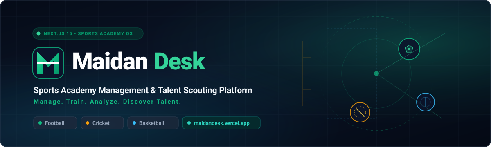
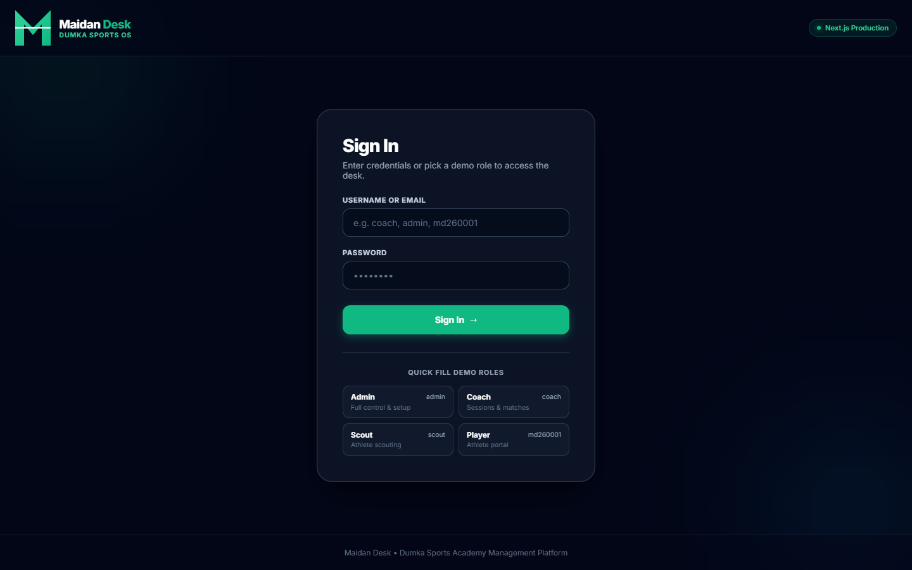
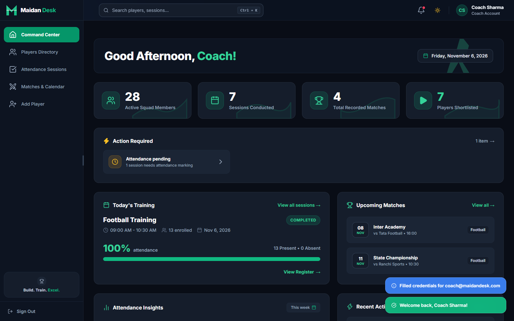
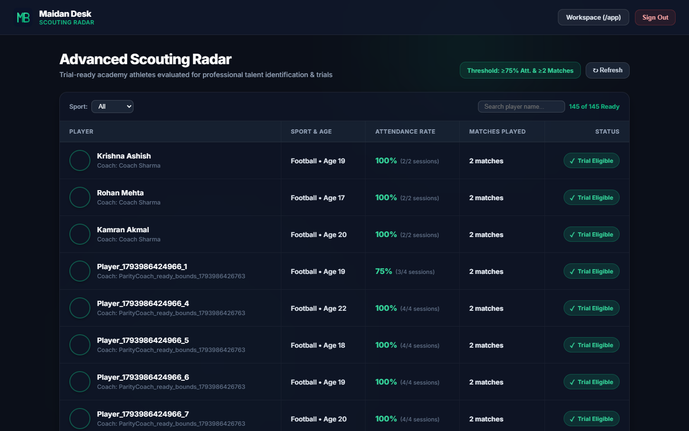
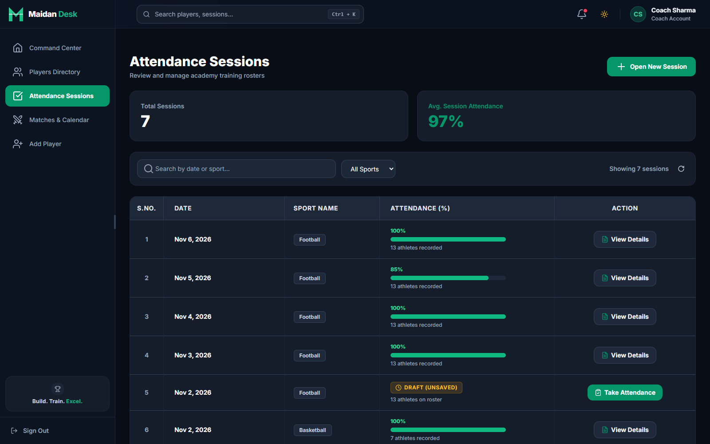
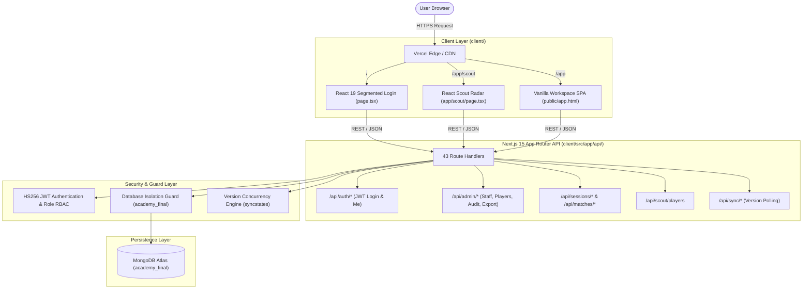

<!-- Hero Banner -->
<p align="center">
  <a href="https://maidandesk.vercel.app">
    
  </a>
</p>

<!-- Dynamic Shields & Status Badges -->
<p align="center">
  <a href="https://github.com/kamranakmal749/vibe-coding-challenge-2-0-vibenerds/actions/workflows/ci.yml">
    
  </a>
  <a href="https://maidandesk.vercel.app">
    
  </a>
  <a href="https://nextjs.org">
    
  </a>
  <a href="https://react.dev">
    
  </a>
  <a href="https://www.typescriptlang.org">
    
  </a>
  <a href="https://www.mongodb.com/atlas">
    
  </a>
  <a href="LICENSE">
    
  </a>
</p>

<!-- Primary Action Links -->
<p align="center">
  <a href="https://maidandesk.vercel.app"><b>🚀 Live Application</b></a> •
  <a href="#-evaluation-access--test-credentials"><b>🔑 Test Credentials</b></a> •
  <a href="#-system-architecture"><b>📐 Architecture</b></a> •
  <a href="docs/SCREENSHOTS.md"><b>📸 Visual Tour & Gallery</b></a> •
  <a href="docs/README.md"><b>📚 Documentation Index</b></a>
</p>

---

## 📌 Executive Summary

**Maidan Desk** is a high-performance sports academy management system and talent scouting platform engineered for grassroots athletic academies across multi-sport disciplines (**Football**, **Cricket**, and **Basketball**).

Developed with Next.js 15 App Router, React 19, TypeScript, and MongoDB Atlas, Maidan Desk solves the critical operational bottlenecks of athletic academies: eliminating paper attendance tracking, enforcing dynamic squad eligibility rules for competitive fixtures, safeguarding athlete health and participation metrics, and empowering talent scouts with real-time, data-backed trial readiness radars.

### Key Capabilities at a Glance

- 🏟️ **Multi-Sport Operational Hub**: Unified roster and fixture scheduling across Football, Cricket, and Basketball.
- ⚡ **Atomic Attendance Sessions**: Fast, default-present daily attendance with per-athlete participation granularity (`practice`, `match`, `both`) and tamper-resistant session locking.
- 🎯 **Scouting Radar**: Automated talent discovery filtering athletes against strict quantitative criteria ($\ge 75\%$ attendance and $\ge 2$ competitive matches) with client-side PDF dossier export.
- 🛡️ **Role-Based Governance**: Four isolated user spaces (**Admin**, **Coach**, **Scout**, **Player**) backed by HS256 JWT security and comprehensive administrative audit logging.
- 🔄 **Real-Time Synchronisation**: Optimistic concurrency control and version-tracked sync polling across distributed client sessions.

---

## 📸 Interface Showcase

| Role-Segmented Login (`/`) | Coach Command Center (`/app`) |
|:---:|:---:|
| <a href="docs/SCREENSHOTS.md#1-role-segmented-authentication"></a> | <a href="docs/SCREENSHOTS.md#2-coach-overview--command-center"></a> |
| *Segmented 4-role switcher with 1-click test credentials* | *Upcoming fixtures, turnout metrics, and squad breakdown* |

| Scouting Talent Radar (`/app/scout`) | Attendance Session Ledger (`/app`) |
|:---:|:---:|
| <a href="docs/SCREENSHOTS.md#6-scouting-radar--talent-discovery"></a> | <a href="docs/SCREENSHOTS.md#4-training-attendance-sessions--roster"></a> |
| *Real-time trial qualification radar with PDF export* | *Default-present marking, participation modes & lock* |

👉 **[View the Complete 9-Screen Visual Tour in docs/SCREENSHOTS.md](docs/SCREENSHOTS.md)**

---

## 🔑 Evaluation Access & Test Credentials

The live deployment at **[https://maidandesk.vercel.app](https://maidandesk.vercel.app)** is pre-seeded with a comprehensive test dataset in `academy_final`. The login screen at `/` features **one-click credential buttons** for each role:

| Segment Tab | Role | Username | Password | Target Portal / Assigned Profile | Core Permissions & Focus |
|:---:|:---:|:---:|:---:|:---|:---|
| **Admin** | Academy Administrator | `admin` | `admin123` | Governance Workspace (`/app`) | Staff provisioning, password resets, roster management, CSV exports, audit trail |
| **Coach** | Senior Academy Coach | `coach` | `coach123` | Coach Workspace (`/app`) | Training sessions, attendance locking, match creation, squad eligibility, match scoring |
| **Scout** | Talent Evaluator | `scout` | `scout123` | Scout Radar (`/app/scout`) | Talent discovery radar, multi-sport filters, trial qualification dossier, PDF export |
| **Player** | Athlete (Ready) | `md260001` | `player123` | Player Portal (`/app`) | Kamran Akmal (Football) — **TRIAL READY** (100% attendance, 2 matches played) |
| **Player** | Athlete (Developing) | `md260003` | `player123` | Player Portal (`/app`) | Aadil Azhar (Football) — **NOT READY** (50% attendance, 1 match played) |

> [!NOTE]
> Evaluators never need to run database seeds. All collections are persistent, operational, and immediately accessible.

---

## 👥 The Four User Roles

Maidan Desk features strict architectural separation of concerns across four distinct user personas:

```
┌────────────────────────────────────────────────────────────────────────┐
│                        MAIDAN DESK USER ROLES                          │
├──────────────┬──────────────────┬─────────────────┬────────────────────┤
│   🛡️ ADMIN   │    📋 COACH      │    🔍 SCOUT     │     🏃 PLAYER      │
├──────────────┼──────────────────┼─────────────────┼────────────────────┤
│ • Staff CRUD │ • Daily Sessions │ • Talent Radar  │ • Personal Portal  │
│ • Password   │ • Attendance     │ • Readiness     │ • Attendance       │
│   Resets       Locking            Thresholds      │   Record           │
│ • Player     │ • Match Fixtures │ • Performance   │ • Match Ledger     │
│   Lifecycle  │ • Squad Selection  Star Ratings    │ • Readiness        │
│ • Audit Log  │ • Match Scores   │ • PDF Dossier   │   Indicator        │
│ • CSV Export │ • Squad Analytics  Export          │ • Coach Feedback   │
└──────────────┴──────────────────┴─────────────────┴────────────────────┘
```

### 1. Academy Administrator (`admin`)
- **Staff Provisioning**: Create and manage Coaches and Scouts with unique usernames and minimum 8-character passwords.
- **One-Time Credential Reveal**: Displays temporary credentials upon creation or reset with single and bulk copy actions.
- **Enforced Security**: Newly created staff accounts have `mustChangePassword` enforced upon initial login.
- **Athlete Lifecycle**: Search, filter, edit athlete profiles, bulk-reassign athletes across coaches, and execute guarded cascade deletions (`{ confirm: true }`).
- **Audit Governance**: Chronological inspection of administrative activities with automatic sanitization of sensitive tokens and passwords.
- **CSV Data Export**: Instant export of player rosters and key performance indicators (`GET /api/admin/export/players?format=csv`).

### 2. Academy Coach (`coach`)
- **Attendance Workflows**: Create dated training sessions with automatic roster population based on assigned sport.
- **Granular Participation**: Mark athletes as Present/Absent with participation modes (`practice`, `match`, `both`).
- **Atomic Locking**: Finalize and lock attendance sessions to ensure immutable records.
- **Match Management**: Schedule competitive fixtures across sports with venue and opponent details.
- **Squad Eligibility**: Dynamic validation ensuring only eligible athletes meeting attendance standards can be drafted.
- **Live Scoring**: Record match results, scores, and participating athlete statistics.

### 3. Talent Scout (`scout`)
- **Native React Scouting Radar (`/app/scout`)**: Dedicated high-speed discovery interface tailored for scouts and talent scouts.
- **Objective Readiness Metric**: Athletes automatically qualify for scouting trials when meeting both benchmarks:
  $$\text{Turnout} \ge 75\% \quad \text{AND} \quad \text{Matches} \ge 2$$
- **Sport-Specific Filtering**: Switch instantly across Football, Cricket, and Basketball prospects.
- **Dynamic Search**: Instant client-side search across athlete names and player identifiers.
- **Client-Side PDF Dossier Export**: Generate and download formatted scouting dossiers in India Standard Time (`Asia/Kolkata`) with zero server overhead.

### 4. Academy Athlete / Player (`player`)
- **Self-Service Portal**: Direct visibility into personal athletic development and academy standing.
- **Readiness Tracking**: Transparent view of current trial eligibility status and metrics required to unlock scouting evaluation.
- **Attendance Ledger**: Complete chronological breakdown of attended sessions and training consistency.
- **Match History**: Verified record of competitive match participations, fixture dates, and scores.

---

## 📐 System Architecture

Maidan Desk employs a hybrid Next.js 15 App Router architecture that balances rapid React component rendering with a battle-tested workspace:



### Architectural Highlights
- **100% Next.js Route Handlers**: 43 modular endpoints handling authentication, athlete lifecycle, attendance records, match fixtures, and audit logs.
- **Database Safety Guard**: The database client strictly enforces connection to the target database `academy_final`.
- **Zero-Secret Client Bundles**: JWT secrets and database connection strings are confined strictly to server-side environments.
- **Dynamic PDF Generation**: Client-side dynamic import of `jspdf` and `jspdf-autotable` prevents bundle bloat on non-scout pages.
- **Legacy Preservation**: The original Express codebase is archived in [`legacy/`](legacy/) for historical reference and test parity; active maintenance scripts in [`scripts/`](scripts/) import Mongoose schemas directly from `legacy/src/models`.

---

## 💻 Tech Stack

| Domain | Technology | Purpose |
|---|---|---|
| **Frontend Framework** | [Next.js 15.1.7](https://nextjs.org/) (App Router) | Core application routing, server components, and asset pipeline |
| **UI Library** | [React 19](https://react.dev/) | Glassmorphic login card and native scouting radar components |
| **Language** | [TypeScript 5.7](https://www.typescriptlang.org/) | Strict type-safety across client models, API payloads, and test suites |
| **Database** | [MongoDB Atlas](https://www.mongodb.com/atlas) / Mongoose | Scalable NoSQL document store with schemas for users, sessions, matches, and audit logs |
| **Authentication** | [jsonwebtoken (HS256)](https://github.com/auth0/node-jsonwebtoken) & [bcryptjs](https://github.com/dcodeIO/bcrypt.js) | Cryptographic password hashing and role-based token validation |
| **Export Utilities** | [jsPDF](https://github.com/parallax/jsPDF) & [jsPDF-AutoTable](https://github.com/simonbengtsson/jsPDF-AutoTable) | Client-side scouting dossier generation |
| **Testing** | Node.js Native Test Runner (`node:test`) | Ultra-fast unit, security, and concurrency test suites |
| **Deployment** | [Vercel](https://vercel.com/) | Global serverless edge hosting (Root Directory: `client`) |

---

## 📁 Repository Structure

```text
maidandesk/
├── client/                     # Active production Next.js 15 application (Vercel Root)
│   ├── public/                 # Static assets & workspace SPA (app.html, script.js, style.css)
│   ├── src/
│   │   ├── app/                # App Router: login (/), scout (/app/scout), and 43 API routes
│   │   │   ├── api/            # Route handlers (admin, auth, matches, players, sessions, scout, sync)
│   │   │   ├── app/scout/      # React Scout Radar page & styles
│   │   │   ├── page.tsx        # React segmented 4-role login component
│   │   │   └── layout.tsx      # Root Next.js layout & global styles
│   │   └── lib/                # Database connection, Mongoose models, auth guards, IST helpers
│   ├── test/                   # Automated unit, integration, and security tests (61 tests)
│   ├── next.config.mjs         # Production Next.js config & rewrite rules
│   └── package.json            # Client dependencies and build scripts
│
├── docs/                       # Comprehensive documentation & asset showcase
│   ├── assets/                 # Vector brand banners & production screenshots
│   │   ├── maidan-desk-banner.svg
│   │   └── screenshots/        # 9 high-resolution production screen captures
│   ├── README.md               # Documentation directory index
│   ├── SCREENSHOTS.md          # Visual tour & screenshot gallery
│   └── PROJECT_CONTEXT.md      # Historical design notes & domain rules (archived)
│
├── scripts/                    # Operational & maintenance utilities
│   ├── seed.js                 # Guarded database seed script (restricted to academy_final)
│   └── verify-academy-final.js # Read-only database link integrity & readiness verifier
│
├── legacy/                     # Archived Express implementation (models used by scripts/seed.js)
│   ├── src/                    # Original Express controllers, middleware, and models
│   ├── public/                 # Original standalone vanilla HTML/JS/CSS assets
│   ├── server.js               # Original Express entrypoint
│   └── README.md               # Legacy architecture notes
│
├── .github/                    # GitHub actions CI workflows and issue templates
├── KNOWN_ISSUES.md             # Resolved items, technical debt, and architectural trade-offs
├── CHANGELOG.md                # Chronological history of releases and enhancements
├── CONTRIBUTING.md             # Developer contribution guidelines
├── SECURITY.md                 # Security vulnerability disclosure policy
├── LICENSE                     # MIT License
└── package.json                # Root package manifest & workspace scripts
```

---

## 🛠️ Local Development Setup

### Prerequisites
- Node.js `18.x` or higher (Node.js 20+ recommended)
- npm `9.x` or higher
- A MongoDB Atlas cluster (with database named `academy_final`)

### Quickstart

```bash
# 1. Clone repository
git clone https://github.com/kamranakmal749/vibe-coding-challenge-2-0-vibenerds.git
cd vibe-coding-challenge-2-0-vibenerds/client

# 2. Install dependencies
npm ci

# 3. Configure environment variables
# Copy template and populate your MongoDB URI and JWT Secret
cp .env.example .env.local

# 4. Run automated test suite (61 tests, zero external dependencies)
npm test

# 5. Launch local development server
npm run dev
```

Visit [http://localhost:3000](http://localhost:3000) to access the application.

---

## ⚙️ Environment Variables

Configure the following variables in `client/.env.local` for local execution, or in the Vercel Dashboard for production:

| Variable | Description | Type | Example Value |
|---|---|:---:|---|
| `MONGODB_URI` | MongoDB Atlas connection string. **Must end in `/academy_final`**. | Required | `mongodb+srv://<user>:<password>@cluster.mongodb.net/academy_final?retryWrites=true&w=majority` |
| `JWT_SECRET` | Secret key for signing HS256 JWT authentication tokens (min 32 characters). | Required | `production_jwt_signing_secret_min_32_characters_long` |
| `ALLOW_PRODUCTION_DB` | Safety guard confirming connection to production database `academy_final`. | Required | `true` |
| `ALLOW_MOCK_NOW` | Time-travel testing flag. **Strictly prohibited in production environments.** | Dev Only | `false` |

---

## 🔒 Guarded Database Seeding

> [!WARNING]
> **DO NOT execute database seeding during evaluation.**
> The production database at [https://maidandesk.vercel.app](https://maidandesk.vercel.app) is pre-populated with active athletes, attendance sessions, and match records. Seeding will wipe and recreate all collections.

For authorized maintainers provisioning a fresh development or staging cluster, `scripts/seed.js` enforces **multi-tier safety checks**:
1. Target database in `MONGODB_URI` must end with `/academy_final`.
2. `ALLOW_PRODUCTION_DB=true` must be set.
3. An explicit destructive confirmation variable `CONFIRM_DESTRUCTIVE_SEED` must be passed:

```bash
ALLOW_PRODUCTION_DB="true" \
CONFIRM_DESTRUCTIVE_SEED="I_ACKNOWLEDGE_THIS_DESTROYS_DATA" \
MONGODB_URI="mongodb+srv://<user>:<pass>@cluster.mongodb.net/academy_final?retryWrites=true&w=majority" \
node scripts/seed.js
```

---

## 🚀 Deployment to Vercel

1. **Import Repository**: In the [Vercel Dashboard](https://vercel.com/), import the repository.
2. **Configure Project Settings**:
   - Set **Root Directory** to `client`.
   - Framework Preset: **Next.js** (detected automatically).
3. **Set Environment Variables**:
   - `MONGODB_URI`: Atlas connection string targeting `academy_final`.
   - `JWT_SECRET`: Random 32+ character signing key.
   - `ALLOW_PRODUCTION_DB`: Set to `true`.
4. **Deploy**: Click **Deploy**. Vercel will build and host both the Next.js API route handlers and static workspace assets seamlessly.

---

## 🧪 Testing & Verification

The test suite in `client/test/` runs natively without requiring an active database or live network connection:

```bash
cd client

# Run all 61 automated tests
npm test

# Run TypeScript type check
npm run typecheck

# Run production Next.js build
npm run build
```

---

## 📄 License & Maintainer

Distributed under the **MIT License**. See [LICENSE](LICENSE) for full details.

Developed & Maintained by **Kamran Akmal** ([@kamranakmal749](https://github.com/kamranakmal749)) for the **Vibe Coding Challenge 2.0**.
