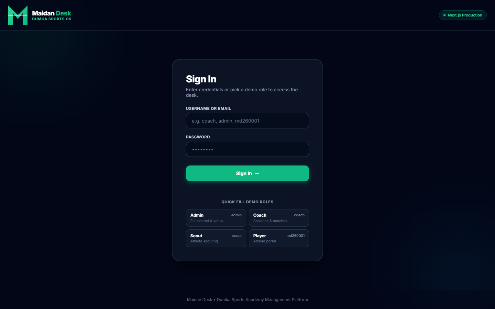
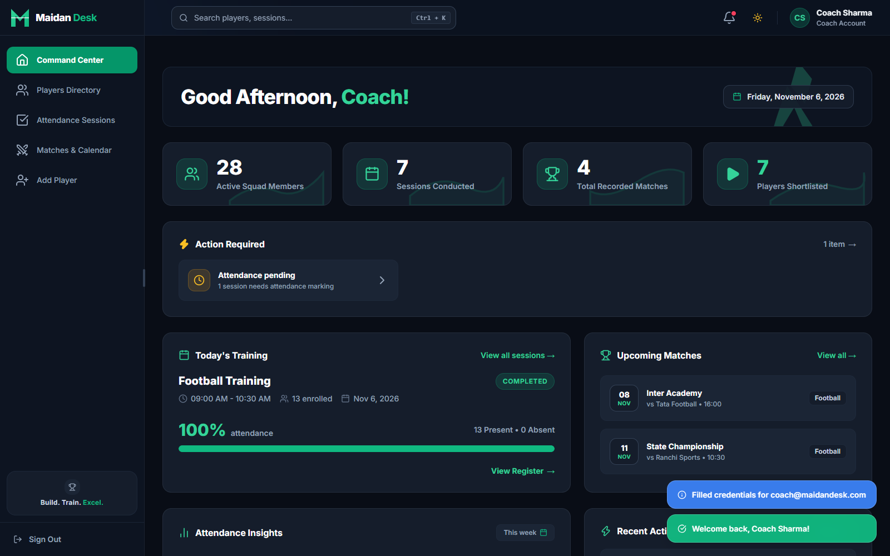
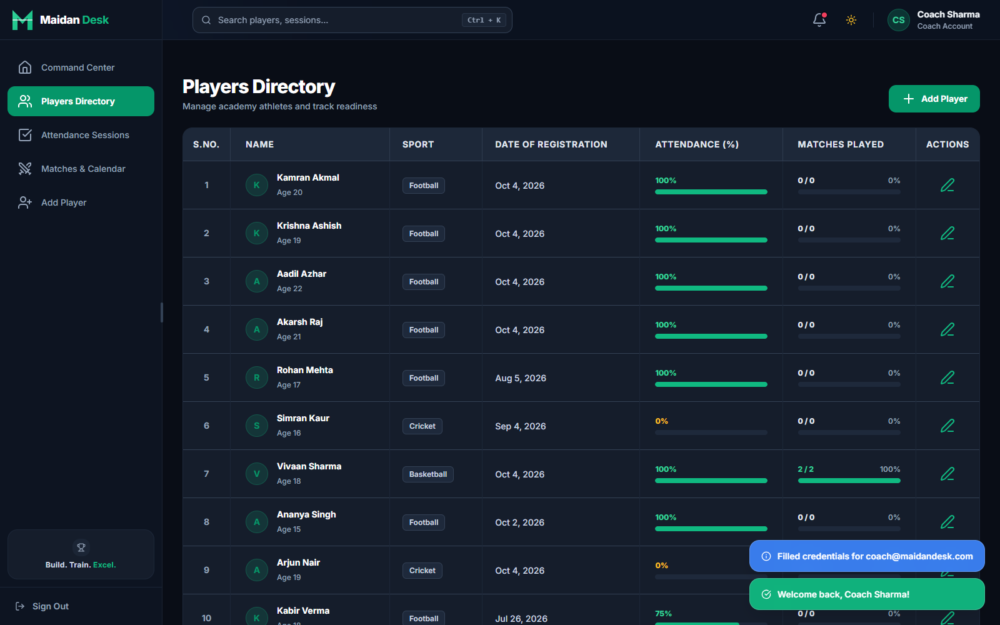
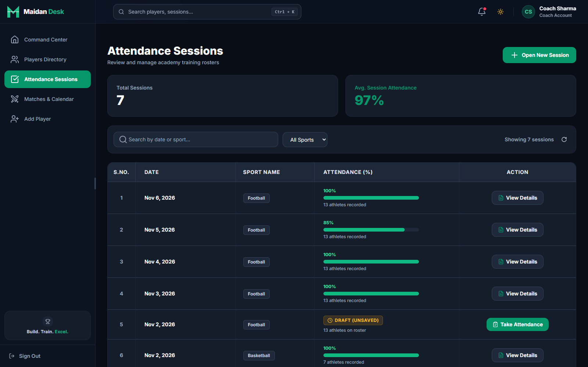
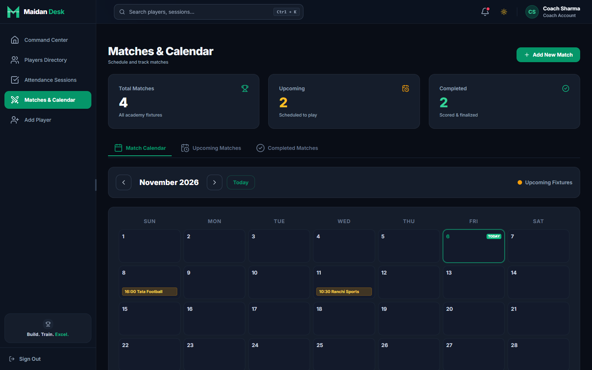
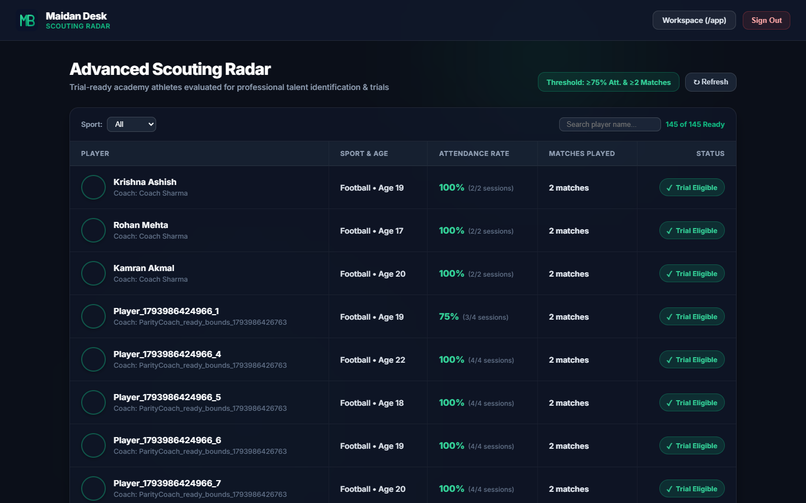
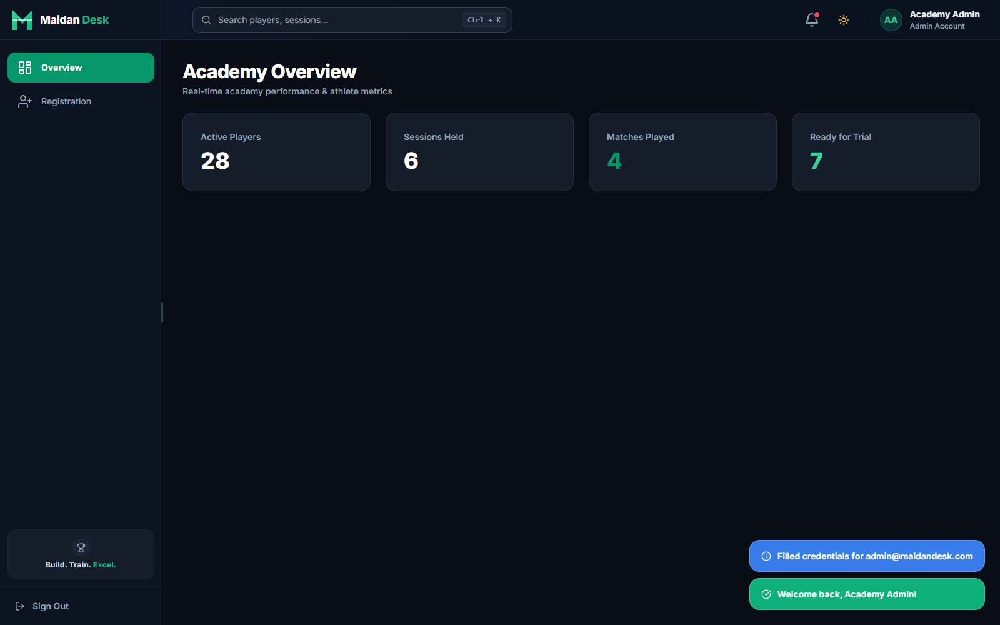
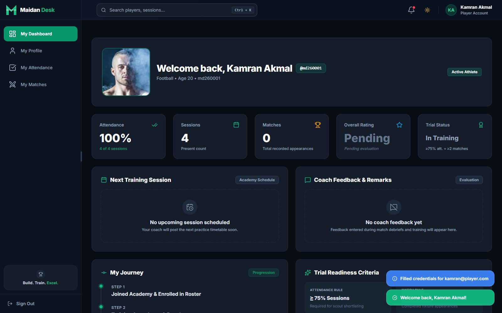
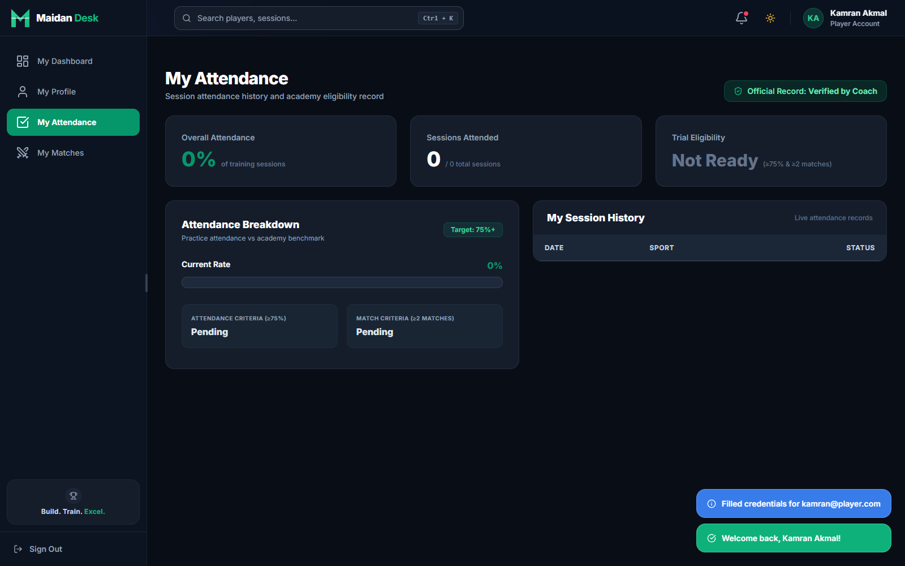

# Maidan Desk — Visual Tour & Screenshots

This gallery showcases the core user workflows, role-specific interfaces, and administrative operations of **Maidan Desk** across its multi-sport operations (**Football**, **Cricket**, **Basketball**).

All screenshots are captured directly from the live production deployment at [maidandesk.vercel.app](https://maidandesk.vercel.app).

---

## Table of Contents

1. [Role-Segmented Authentication](#1-role-segmented-authentication)
2. [Coach Overview & Command Center](#2-coach-overview--command-center)
3. [Players Directory & Squad Analytics](#3-players-directory--squad-analytics)
4. [Training Attendance Sessions & Roster](#4-training-attendance-sessions--roster)
5. [Matches, Fixtures & Scoring Calendar](#5-matches-fixtures--scoring-calendar)
6. [Scouting Radar & Talent Discovery](#6-scouting-radar--talent-discovery)
7. [Admin Governance, Staff & Audit Trail](#7-admin-governance-staff--audit-trail)
8. [Player Portal & Performance Readiness](#8-player-portal--performance-readiness)
9. [Player Attendance Ledger & Match History](#9-player-attendance-ledger--match-history)

---

### 1. Role-Segmented Authentication
The glassmorphic React login screen provides one-click role switching (**Admin**, **Coach**, **Scout**, **Player**), dynamic contextual guidance, and instant test credential auto-filling for streamlined evaluator access.

*Route: `/` — Features 4 dedicated role tabs, real-time input placeholder adjustments, and one-click test credentials.*

---

### 2. Coach Overview & Command Center
The academy command center gives coaches immediate visibility into upcoming match fixtures, session turnout statistics, multi-sport attendance distribution, and quick action shortcuts.

*Route: `/app` (Overview) — Active training summaries, readiness distributions across Football/Cricket/Basketball, and quick links.*

---

### 3. Players Directory & Squad Analytics
A centralized, searchable directory of academy athletes. Coaches and administrators can filter athletes by sport, assigned coach, or text search, with real-time indicators for attendance percentage, match count, and trial readiness.

*Route: `/app` (Players) — Multi-sport roster filtering, dynamic trial indicators, one-click CSV export, and bulk coach reassignment.*

---

### 4. Training Attendance Sessions & Roster
Daily attendance tracking engineered with default-present workflows, per-player participation mode granularity (`practice`, `match`, `both`), and atomic locking to prevent retroactive alteration.

*Route: `/app` (Sessions) — Fast attendance taking, unified roster modal, present/absent toggling, and locked session protection.*

---

### 5. Matches, Fixtures & Scoring Calendar
Comprehensive fixture planning across Football, Cricket, and Basketball. Supports match scheduling, dynamic squad eligibility checks (based on minimum attendance thresholds), and post-match scorecard recording.

*Route: `/app` (Matches) — Scheduled fixtures, match statuses (`scheduled`, `in_progress`, `completed`), and dynamic squad sheets.*

---

### 6. Scouting Radar & Talent Discovery
A dedicated React interface engineered for professional talent scouts. Automatically surfaces trial-ready athletes meeting strict academy benchmarks ($\ge 75\%$ attendance turnout and $\ge 2$ matches played) with dynamic multi-criteria search and PDF scouting dossier export.

*Route: `/app/scout` — Real-time qualification badges, per-sport filtering, and instant client-side PDF export.*

---

### 7. Admin Governance, Staff & Audit Trail
Academy directors manage staff provisioning (Coaches and Scouts), enforce one-time password reveal protocols, safeguard athlete records with cascade protections, and inspect immutable system audit logs.

*Route: `/app` (Staff / Audit Log) — Role provisioning, temporary password reset with mandatory first-login change, and sanitized audit trail.*

---

### 8. Player Portal & Performance Readiness
Athletes access their personalized performance dashboard highlighting training attendance consistency, upcoming fixtures, coach feedback, and real-time trial readiness qualification.

*Route: `/app` (Player Account) — Individual turnout rate, match eligibility status, and assigned coach details.*

---

### 9. Player Attendance Ledger & Match History
Athletes inspect their complete historical attendance log and match participation ledger with transparent status tracking for complete accountability.

*Route: `/app` (Player History) — Chronological training breakdown, status stamps, and verified match participations.*

---

[← Return to Repository README](../README.md) | [Explore Architecture & API Docs](README.md)

